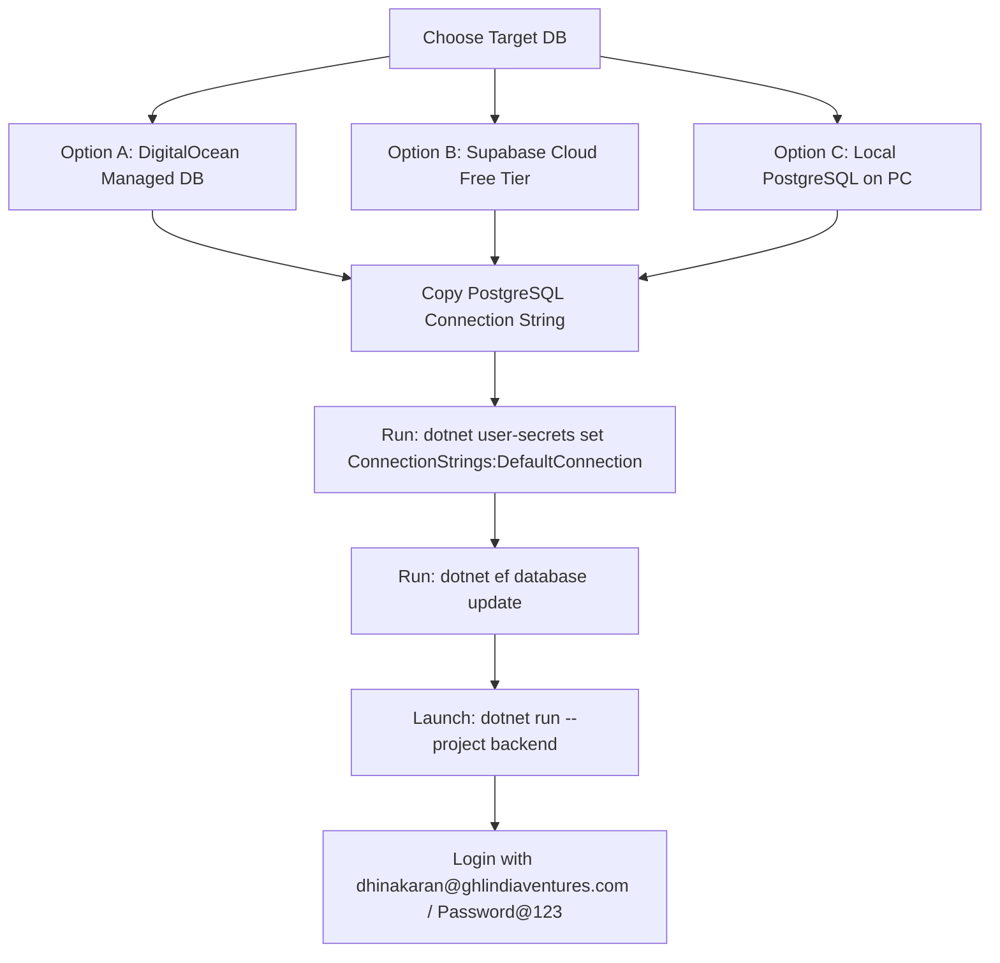
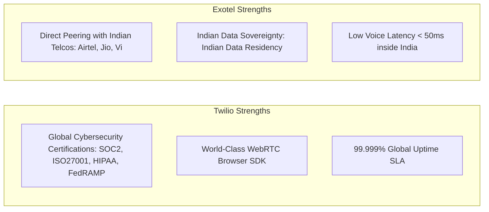

# NexusSales Platform – Database Migration & Telephony Infrastructure Guide

> **Document Version:** 1.0  
> **Last Updated:** October 2026  
> **Target Project:** `VishnuNagarajanS/sales_rep_app`  
> **Backend Architecture:** .NET 8 Web API + Entity Framework Core (PostgreSQL)  
> **Frontend Architecture:** React 18 + TypeScript + Vite  

---

## 1. Executive Summary

This document serves as an end-to-end technical reference and operations handbook addressing:
1. **Database Migration Strategy:** Resolving the Neon Free Tier quota exhaustion (`monthly network transfer allowance limit`) and transitioning seamlessly to DigitalOcean, Supabase, or Local PostgreSQL.
2. **Schema & Credentials Inventory:** Full catalog of the **39 tables**, pre-configured tenants, system roles, and out-of-the-box user accounts with auto-seeded credentials.
3. **Telephony & Messaging Evaluation:** In-depth technical comparison of **Twilio vs. Exotel** focusing on **Quality** and **Security**, along with implementation requirements for SMS and Calling.

---

## 2. Full Database Schema & Entities Catalog (39 Tables)

The platform runs on **Entity Framework Core Code-First Migrations** (`backend/Data/ApplicationDbContext.cs`). The complete list of 39 managed tables categorized by business domain:

### A. Core Platform & Identity
| Table Name | Description | Key Model |
| :--- | :--- | :--- |
| `tenants` | Multi-tenant organization boundaries (GHL, Jamin) | `Tenant` |
| `roles` | System roles & granular permission arrays | `Role` |
| `users` | User accounts, hashed passwords, tenant & role mappings | `User` |
| `user_sessions` | Active JWT tokens, device tracking & revocation | `UserSession` |
| `security_events` | Platform security events, IP tracking & audit | `SecurityEvent` |
| `password_reset_tokens` | Secure token store for user password resets | `PasswordResetToken` |
| `documents` | Metadata store for KYC documents, PAN, Aadhaar | `Document` |

### B. Sales Pipeline, Contacts & Leads
| Table Name | Description | Key Model |
| :--- | :--- | :--- |
| `leads` | Inbound & qualified leads, custom fields, status | `Lead` |
| `lead_assignment_histories` | Audit log of lead reassignments across agents | `LeadAssignmentHistory` |
| `customers` | Converted Customer 360 dossiers | `Customer` |
| `followups` | Scheduled callbacks, reminders, priorities | `Followup` |
| `consultations` | Wealth advisory consultation sessions | `Consultation` |
| `call_records` | Detailed telephony logs, durations, recordings | `CallRecord` |
| `executive_profiles` | Sales Executive performance & skill matrix | `ExecutiveProfile` |

### C. GHL Deals & Institutional Pipeline
| Table Name | Description | Key Model |
| :--- | :--- | :--- |
| `ghl_deals` | Deals in the sales pipeline Kanban board | `GhlDeal` |
| `ghl_deal_activities` | Timeline notes, stages, call logs per deal | `GhlDealActivity` |
| `ghl_investment_opportunities` | High-ticket investor opportunities pipeline | `GhlInvestmentOpportunity` |

### D. Investor Relations Manager (IRM) & KYC Verification Desk
| Table Name | Description | Key Model |
| :--- | :--- | :--- |
| `investors` | HNI investor master registry | `Investor` |
| `investor_kycs` | SEBI/PMLA KYC onboarding & document review | `InvestorKyc` |
| `investment_opportunities` | IRM deal structuring & tickets | `InvestmentOpportunity` |
| `kyc_otp_verifications` | OTP verification records for assisted onboarding | `KycOtpVerification` |
| `irm_coverage_assignments` | Temporary IRM coverage and surrogate mappings | `IrmCoverageAssignment` |

### E. Work Handover & HR Leave Governance
| Table Name | Description | Key Model |
| :--- | :--- | :--- |
| `work_handovers` | Active custody transfer of client accounts | `WorkHandover` |
| `work_handover_items` | Specific leads, deals, investors attached to handover | `WorkHandoverItem` |
| `leave_requests` | Employee leave applications & approval status | `LeaveRequest` |
| `leave_policies` | Company leave entitlement rules & quotas | `LeavePolicy` |
| `leave_request_events` | Immutable timeline of leave lifecycle actions | `LeaveRequestEvent` |

### F. Telephony, Subscriptions & System Administration
| Table Name | Description | Key Model |
| :--- | :--- | :--- |
| `subscription_packages` | Platform tier definitions and quotas | `SubscriptionPackage` |
| `carrier_settings` | Twilio / telephony carrier credentials | `CarrierSettings` |
| `tenant_did_mappings` | DID virtual phone number routing to tenants | `TenantDidMapping` |
| `broadcast_announcements` | System-wide banner announcements | `BroadcastAnnouncement` |
| `platform_settings` | Global feature flags and configuration | `PlatformSetting` |
| `audit_logs` | Platform-wide immutable audit trail | `AuditLog` |
| `notifications` | User notification center alerts | `Notification` |
| `ai_chat_logs` | History of interactions with platform AI Assistant | `AiChatLog` |

*(Plus 4 legacy mapping models maintained for backward compatibility).*

---

## 3. Pre-Configured Seed Data & Default User Accounts

> [!IMPORTANT]
> When switching to a brand new database, **YOU DO NOT NEED TO MANUALLY RE-CREATE CREDENTIALS**.  
> EF Core's `SeedData` method automatically generates all Tenants, Roles, and Users upon running `dotnet ef database update` or starting the application.

### A. Pre-Seeded Tenants
1. **GHL India Ventures** (`Id: 1`, `Slug: ghl`) – Wealth Management & Capital Advisory
2. **Jamin Bazaar** (`Id: 2`, `Slug: jamin`) – Farmland & Real Estate Communities

### B. Pre-Seeded System Roles
1. `super_admin` (`Id: 1`) – Full platform governance across all tenants
2. `company_admin` (`Id: 2`) – Tenant administration, users, and business settings
3. `sales_executive` (`Id: 3`) – Outbound dialer, lead progression, and client calls
4. `irm` (`Id: 4`) – Investor Relations Manager for KYC, HNIs, and Deals

### C. Active Login Accounts Matrix
All pre-seeded accounts share the uniform default password: **`Password@123`**

| Role | User Name | Login Email | Default Password | Tenant Assigned |
| :--- | :--- | :--- | :--- | :--- |
| **Super Admin** | Yanosh | `yanosh@ghlindiaventures.com` | `Password@123` | Global Platform |
| **Company Admin** | Vishnu | `vishnu@ghlindiaventures.com` | `Password@123` | GHL India (`1`) |
| **Company Admin** | Mani | `mani@ghlindiaventures.com` | `Password@123` | Jamin Bazaar (`2`) |
| **IRM (Investor Relations)** | Dhinakaran | `dhinakaran@ghlindiaventures.com` | `Password@123` | GHL India (`1`) |
| **Sales Executive** | Naveen | `naveen@ghlindiaventures.com` | `Password@123` | GHL India (`1`) |
| **Sales Executive** | Rajesh Sharma | `rajesh@jaminbazaar.com` | `Password@123` | Jamin Bazaar (`2`) |
| **Executive** | Priya | `priya@ghlindiaventures.com` | `Password@123` | GHL India (`1`) |

---

## 4. End-to-End Database Migration Steps (From Scratch)

Choose your target PostgreSQL hosting platform:



### Step 1: Provision the Database

#### Option A: DigitalOcean Managed PostgreSQL Cluster
1. Log in to [cloud.digitalocean.com](https://cloud.digitalocean.com).
2. Navigate to **Databases** > **Create Database Cluster**.
3. Select **PostgreSQL 16**.
4. Choose **Basic Plan ($15/mo)** and select the datacenter closest to you (`BLR1 - Bangalore`).
5. In **Connection Details**, copy the connection parameters:
   - Host, Port (`25060`), Database (`defaultdb`), User (`doadmin`), Password, SSL (`Required`).

#### Option B: Supabase (100% Free Cloud Alternative)
1. Sign in at [supabase.com](https://supabase.com).
2. Click **New Project** > Name: `sales-rep-app` > Set secure DB password > Region: `South Asia (Mumbai)`.
3. In Project Settings > Database > **Connection String**, copy the URI (Mode: Session Pooler on Port `5432` or Direct on `5432`).

#### Option C: Local PostgreSQL (Offline, 100% Free Forever)
1. Install PostgreSQL via [Official Windows Installer](https://www.postgresql.org/download/windows/).
2. Remember the master password set during install (e.g. `admin123`).
3. Open pgAdmin or command prompt and create a database: `CREATE DATABASE sales_rep_db;`.

---

### Step 2: Configure Backend Connection String
Open your terminal in the workspace root (`c:\Users\ADMIN\Desktop\sales_rep_app`) and execute:

* **For DigitalOcean:**
  ```powershell
  dotnet user-secrets set "ConnectionStrings:DefaultConnection" "Host=db-postgresql-blr1-xxxxx.b.db.ondigitalocean.com;Port=25060;Database=defaultdb;Username=doadmin;Password=YOUR_PASSWORD;SSL Mode=Require;Trust Server Certificate=true;Maximum Pool Size=5;Minimum Pool Size=0;Connection Idle Lifetime=15;Connection Pruning Interval=5;" --project backend
  ```

* **For Supabase:**
  ```powershell
  dotnet user-secrets set "ConnectionStrings:DefaultConnection" "Host=aws-0-ap-south-1.pooler.supabase.com;Port=5432;Database=postgres;Username=postgres.YOUR_USER;Password=YOUR_PASSWORD;SSL Mode=Require;Trust Server Certificate=true;" --project backend
  ```

* **For Local PostgreSQL:**
  ```powershell
  dotnet user-secrets set "ConnectionStrings:DefaultConnection" "Host=localhost;Port=5432;Database=sales_rep_db;Username=postgres;Password=YOUR_PASSWORD;" --project backend
  ```

---

### Step 3: Run Migrations (Automatic Table Creation)
Run Entity Framework Core migration update:

```powershell
dotnet ef database update --project backend
```

> [!TIP]
> This command will execute all pending migrations, create all 39 tables, set up primary/foreign key constraints, and seed initial tenants, roles, and user accounts automatically.

---

### Step 4: Start the Applications & Verify
1. Restart the backend API:
   ```powershell
   dotnet run --project backend
   ```
2. Frontend is accessible at `http://localhost:5173`.
3. Log in with:
   - **Email:** `dhinakaran@ghlindiaventures.com` (or `vishnu@ghlindiaventures.com`)
   - **Password:** `Password@123`

---

## 5. Telephony Infrastructure Evaluation: Twilio vs. Exotel

*(Strict evaluation focused exclusively on **Quality** and **Security** without price factors).*



### Detailed Quality & Security Comparison

| Evaluation Metric | Twilio | Exotel | Analysis & Winner |
| :--- | :--- | :--- | :--- |
| **Cybersecurity Certifications** | **SOC 2 Type II, ISO 27001, HIPAA, PCI-DSS Level 1, GDPR, FedRAMP Authorized** | ISO 27001, SOC 2, VAPT Audited | **Twilio Wins:** Twilio possesses the most stringent international enterprise security credentials in cloud communications. |
| **Voice Data Encryption** | **SRTP (Secure Real-time Transport Protocol)** for WebRTC voice + **AES-256** for recordings | TLS for APIs + Standard telecom-grade media encryption | **Twilio Wins:** Comprehensive end-to-end SRTP encryption across all WebRTC client audio streams. |
| **Indian Data Residency (DPDP Act)** | Global AWS edge nodes (Data may traverse international points of presence) | **100% Indian Data Centers (AWS Mumbai & Local DC)** | **Exotel Wins for India:** All call data, CDRs, and recordings remain strictly inside Indian borders, complying with SEBI and RBI regulatory mandates. |
| **Call Quality to Indian Numbers (+91)** | Routes via international carrier hops unless dedicated Indian peering is secured (150ms–250ms latency) | **Direct PRI/SIP Interconnects with Tier-1 Indian Telcos (Jio, Airtel, Vi)** | **Exotel Wins for India:** Ultra-low latency (<50ms), pristine audio clarity, and minimal packet loss when dialing Indian mobiles. |
| **Call Connect Rate (Answer Seizure)** | Higher chance of being flagged as international spam unless DLT + Indian CLI is configured | Native Indian CLI (+91 Virtual Number), high pickup rate | **Exotel Wins for India:** Lower spam-filtering rate on Indian handsets and Truecaller. |
| **Global Network & Multi-Country Reach** | **180+ Countries covered with Global Super Network** | Primarily India and Southeast Asia | **Twilio Wins Globally:** Unmatched reliability for worldwide client reach. |
| **WebRTC In-Browser Calling Quality** | World-class JavaScript Voice SDK with adaptive jitter buffers & Twilio Voice Insights | In-browser calling available, but client SDK ecosystem is more legacy | **Twilio Wins:** Superior developer experience and real-time audio stability in browser environments. |

---

## 6. Current Codebase Implementation Status (Calling & Messaging)

### Current Capabilities:
1. **Twilio Voice Calling:** Fully implemented and configured in `backend/Controllers/Voice/` using Twilio Voice SDK tokens and TwiML dial routing.
2. **Email Delivery:** Fully implemented via Gmail SMTP (`smtp.gmail.com`).
3. **SMS Dispatch Status:**
   - **Frontend:** UI controls and channels are active in disposition wrap-up and KYC sharing.
   - **Backend:** Currently returns `"SMS delivery unavailable: No SMS gateway provider is configured"`. To enable live SMS dispatch, integrate Twilio's `MessageResource.CreateAsync` or an Indian SMS gateway (e.g. MSG91 / Fast2SMS).

---

## 7. Strategic Recommendations

1. **For Database:** If monthly cost must be ₹0, utilize **Supabase Free Tier** or **Local PostgreSQL**. If deploying for production enterprise use, select **DigitalOcean Managed PostgreSQL**.
2. **For Telephony:**
   - If your primary client base is **Indian HNIs (+91)**: Prioritize **Exotel** for superior call pickup rates and Indian data sovereignty.
   - If your platform targets **Global Investors (US, UK, NRI clients)** and demands premier browser WebRTC stability: Retain **Twilio**.
3. **For SMS:** Connect **MSG91** or **Twilio SMS** to activate live KYC link sharing and missed-call reminders.
