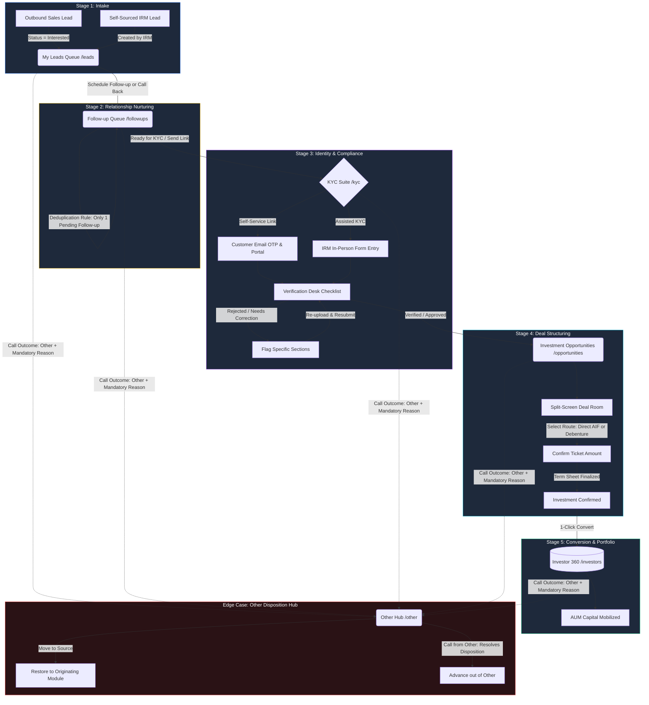
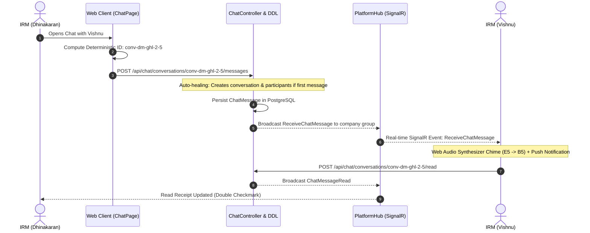

# Investor Relations Manager (IRM) – Complete Feature Inventory, Workflow & Merge Specification

> **Document Version:** 2.0 (Master Merge Specification)  
> **Target Role:** Investor Relations Manager (`irm`)  
> **Tenant Ecosystem:** GHL India Ventures (Investment & Wealth Management)  
> **Active Git Branch:** `dhinakaran`  
> **Merge Targets:** `main`, `vishnu-dev`, `Yanosh-P`  
> **Last Updated:** October 2026  

---

## Table of Contents
1. [Executive Summary & Document Purpose](#1-executive-summary--document-purpose)
2. [Comprehensive Inventory of Changes Made (Git & Delta Log)](#2-comprehensive-inventory-of-changes-made-git--delta-log)
3. [End-to-End Flow of Customers in IRM (Lifecycle State Machine)](#3-end-to-end-flow-of-customers-in-irm-lifecycle-state-machine)
4. [IRM Call Outcomes & Disposition Matrix](#4-irm-call-outcomes--disposition-matrix)
5. [Module-by-Module Feature Breakdown](#5-module-by-module-feature-breakdown)
   - [5.1. Dedicated IRM Dashboard (`/dashboard`)](#51-dedicated-irm-dashboard-dashboard)
   - [5.2. All Leads Directory (`/all-leads`)](#52-all-leads-directory-all-leads)
   - [5.3. My Leads (`/leads`)](#53-my-leads-leads)
   - [5.4. Follow-up Management (`/followups`)](#54-follow-up-management-followups)
   - [5.5. KYC (Know Your Customer) Suite (`/kyc`)](#55-kyc-know-your-customer-suite-kyc)
   - [5.6. Investment Opportunities & Deal Room (`/opportunities`)](#56-investment-opportunities--deal-room-opportunities)
   - [5.7. Investor 360 (`/investors`)](#57-investor-360-investors)
   - [5.8. IRM "Other" Disposition Hub (`/other`)](#58-irm-other-disposition-hub-other)
   - [5.9. Pipeline Kanban (`/pipeline`)](#59-pipeline-kanban-pipeline)
   - [5.10. Calling & Softphone Suite (`/call-center`, `/call-history`)](#510-calling--softphone-suite-call-center-call-history)
   - [5.11. Dedicated IRM Reports (`/reports`)](#511-dedicated-irm-reports-reports)
   - [5.12. IRM Profile & Scorecard (`/profile`)](#512-irm-profile--scorecard-profile)
   - [5.13. Collaboration & Real-Time Team Chat Suite (`/chat`)](#513-collaboration--productivity-tools)
6. [Administrative Governance & Workload Coverage](#6-administrative-governance--workload-coverage)
7. [Database Schema, Entities & Migrations](#7-database-schema-entities--migrations)
8. [Complete IRM Backend API Endpoints](#8-complete-irm-backend-api-endpoints)
9. [Pre-Merge Verification & Conflict Prevention Checklist](#9-pre-merge-verification--conflict-prevention-checklist)

---

## 1. Executive Summary & Document Purpose

The **Investor Relations Manager (IRM)** role is a specialized persona in the Nexus platform tailored for **High-Net-Worth Individual (HNI)** client acquisition, institutional wealth management, regulatory compliance (SEBI/PMLA), and private market capital mobilization.

Unlike outbound Sales Executives who process high-volume top-of-funnel leads, an IRM:
- Ingests qualified handovers from outbound sales (`Interested` status) or self-sources private client leads.
- Nurtures investor relationships with structured advisory callbacks and consultations.
- Orchestrates and verifies SEBI-compliant **KYC** workflows (Self-Service with Email OTP & In-Person Assisted KYC).
- Structures deal allocations inside the **Split-Screen Deal Room Workspace** across two primary investment routes:
  1. **Direct AIF Route** (SEBI Cat II AIF, ₹1 Cr minimum, annual distributions).
  2. **Alternate Route to Invest in AIF via Debenture** (Starting ₹10 Lakhs, 24% p.a. assured return, 1% monthly interest payout, Debenture Trustee backing).
- Confirms investment commitments and converts deals into long-term accounts inside **Investor 360**.
- Enforces strict **Pipeline Stage Isolation** to guarantee zero data duplication across functional stages.

> [!IMPORTANT]
> **Merge Context:** This document serves as the master contract and specification for the `dhinakaran` branch. When merging `dhinakaran` into `main`, `vishnu-dev`, or `origin/main`, reference this document to verify that all database mappings, role permissions, routing behaviors, and stage isolation invariants remain intact.

---

## 2. Comprehensive Inventory of Changes Made (Git & Delta Log)

Below is the detailed record of commits and architectural modifications implemented on the `dhinakaran` branch:

### 2.1. Recent Commits Summary
| Commit | Component / Scope | Key Changes & Description |
|---|---|---|
| `7b8e102` | `feat(chat)` | **Real-Time Team Chat & Collaboration Engine:** Full-stack persistence in PostgreSQL (`chat_conversations`, `chat_participants`, `chat_messages`, `chat_attachments`), SignalR Hub (`PlatformHub`), REST Controller (`ChatController`), deterministic DM routing (`conv-dm-{companyId}-{minUserId}-{maxUserId}`) with auto-healing, Web Audio API synthesizer chime (E5 $\rightarrow$ B5), file attachment permissions (`read_only` vs `view_download`), and admin privacy governance. |
| `d7b561f` | `fix(irm)` | **IRM Lead Status & Attribution:** Relaxed lead status constraints to show all IRM-assigned leads (`Interested`, `Callback`, `No Response`, `New`, `Contacted`). Enhanced lead matching in followups by stripping `"lead-"` prefixes, accurate IRM role assignment attribution (`Created by IRM`), and preserving stage retention in call wrap-up modals. |
| `e2a9d89` | `feat(opportunities)` | **Split-Screen Deal Room UI:** Upgraded Opportunity Profile Workspace with Obsidian, Crimson & Olive executive theme. Integrated dual investment route selector (Direct AIF vs. Debenture), quick investment presets, and on-demand fund terms generation. |
| `8327b43` | `feat(kyc)` | **Concept 6 KYC Profile Redesign:** Floating glassmorphism with 2+3 bento layout, verification drawer, dual light/dark mode styling, and responsive status indicators. |
| `58936ac` | `feat(opportunities)` | **Multi-Module Workspace & Live KYC:** Embedded investor dossier, call history, consultations, follow-ups, and live KYC status directly inside the deal room profile view. |
| `af7106c` | `fix(all-leads)` | **Other Disposition Classification:** Accurately classified contacts moved to "Other" via call dispositions, excluded them from KYC stage, added dynamic "In Other" metric card and tab in `AllLeadsPage.tsx`. |
| `06838bc` | `merge` | Integrated remote updates from `origin/vishnu-dev` into `dhinakaran`, resolving shared store and typing dependencies. |
| `f4570be` | `fix(migrations)` | **Idempotent DB Migrations:** Hardened PostgreSQL migrations for audit logs, notifications, and tenant safety. |
| `ee2469c` | `fix(irm)` | **Lead Updates & Wrap-up Dispositions:** Allowed IRMs to update assigned leads safely; prevented invalid disposition drops in call wrap-up modal. |
| `0d524ea` & `71f1d9c` | `docs & fix` | **Zero-Deletion & Table Alignment:** Enforced strict zero-deletion policy for IRMs across all pages; unified table `ACTIONS` column with `white-space: nowrap; flex-shrink: 0`. |
| `c498673` | `feat(handover)` | Added "Returned from Handover" badge, detail banners, and filter options across Leads, Followups, Customers, and Deals. |
| `efa51d3` | `fix(reassign)` | Dynamically loaded and displayed all active IRMs in lead assignment and coverage modal. |
| `d83f9af` | `fix(followups)` | Prevented duplicate follow-ups upon re-engagement and ensured call history drawer renders live telephony logs. |
| `9e37cc1` | `fix(deals)` | Synchronized deal stages with PostgreSQL database and resolved infinite loading loop in KYC verification drawer. |
| `a4f27e9` & `4509d1c` | `feat(other)` | Retained contacts in source module upon `Call Back`, `No Response`, and `Contacted`; added 1-click **Move to Source** button in Other Contacts. |
| `7947e27` | `fix(other)` | Filtered mock simulation contacts from UI and eliminated fake simulation buttons in production mode. |
| `16b0682` | `fix(kyc)` | Allowed direct verification of optional Demat and Nominee sections, added webcam face photo capture in Assisted KYC, and clamped DOB year picker. |

### 2.2. Backend Delta Highlights
- **Services Modified/Created:**
  - `ChatController.cs`: 12 REST endpoints covering company-scoped conversations, paginated message history, read receipts, emoji reactions, multipart attachment uploads, typing status broadcasts, and company chat governance.
  - `PlatformHub.cs`: Real-time SignalR Hub broadcasting `ReceiveChatMessage`, `ChatUserTyping`, `ChatConversationUpdated`, and `ChatMessageRead` to tenant connection groups.
  - `Chat Entities & DDL`: Four strongly-typed EF Core entities (`ChatConversation`, `ChatParticipant`, `ChatMessage`, `ChatAttachment`) backed by idempotent startup DDL in `Program.cs` and migration `20261015064047_AddChatTables.cs`.
  - `FollowupService.cs`: Enhanced ID resolution (`lead-{id}` parsing), lead attribution (`Created by IRM`), automated completion of stale follow-ups when advancing to KYC/Opportunity.
  - `LeadService.cs`: Scoped IRM queries to match `assignedAgentId` or `assignedIrmId` in custom fields JSON.
  - `IrmAllLeadsController.cs`: Integrated `IIrmOtherService` to check whether contacts are currently isolated in "Other" before assigning stage labels.
  - `IrmOtherService.cs`: Dedicated isolation logic for unorthodox call outcomes, normalizing UTC timestamps and supporting colleague coverage visibility.
  - `KycService.cs`: Verification desk logic, per-section check marks, link token lifecycle, and email OTP verification.
  - `OpportunityService.cs` & `GhlDealsController.cs`: Formal investment confirmation flow, stage transitions, and 1-click conversion to Investor 360.
- **Role Model Hardening:**
  - Removed deprecated `sales_manager` role across all controllers and DTOs.
  - Strictly enforced the 4 canonical roles: `super_admin`, `company_admin`, `sales_executive`, `irm`.

### 2.3. Frontend Delta Highlights
- **Real-Time Team Chat & Collaboration (`/chat`):**
  - `chatStorage.ts`: Deterministic DM conversation ID resolution (`conv-dm-{companyId}-{minUserId}-{maxUserId}`) ensuring cross-user sync parity, resilient tenant ID matching (`isMatchingCompany`), optimistic caching, and server-first directory sync.
  - `chatApiService.ts`: Type-safe REST client for conversations, messages, emoji reactions, and multipart file uploads.
  - `chatNotificationSound.ts`: Zero-dependency Web Audio API synthesizer chime (E5 $\rightarrow$ B5) with browser desktop push alerts.
  - `ChatPage.tsx`, `ChatSettingsModal.tsx`, `NewConversationModal.tsx`, `FileShareModal.tsx`: Unread badge tracking, thread replies, typing indicators, governance restrictions (`whoCanDm`, `whoCanCreateGroups`), and file preview/download controls.
- **Layout & CSS Stability:**
  - Added `scrollbar-gutter: stable` to `layout.css` to prevent UI shifting between tabs.
  - Unified table action buttons with guaranteed height (`30px`), `flex-shrink: 0`, and `white-space: nowrap`.
- **Zero-Deletion Enforcement:**
  - Hidden delete buttons on `LeadsPage`, `InvestorsPage`, `OpportunitiesPage`, and `IrmOtherPage` when logged-in role is `irm`.
- **Telephony & Call Dispositions:**
  - Removed "Skip for Now" action from wrap-up modal to prevent unlogged interactions.
  - Required mandatory reason entry whenever disposition is `Other`.
  - Removed `Contacted` option when calling contacts from the Other module to force actionable resolution.

---

## 3. End-to-End Flow of Customers in IRM (Lifecycle State Machine)

The IRM lifecycle is an automated 5-stage progression with strict **Pipeline Stage Isolation**. A contact exists in exactly one primary stage at any given moment.

### 3.1. Customer Flow Diagram



### 3.2. Detailed Stage Transitions & Invariants

| Transition | Trigger / Action | System Behavior & Data Updates | Stage Isolation Guarantee |
|---|---|---|---|
| **Intake → Follow-up** | IRM schedules a follow-up or logs call disposition `Follow-up Required` / `Call Back`. | `Lead.Status` updates to `Follow-up Required`. Follow-up task is inserted with `ScheduledAt` timestamp. | Lead leaves `My Leads` view and immediately appears in `Follow-up`. |
| **Follow-up → KYC** | IRM clicks `Send KYC Link`, initiates `Assisted KYC`, or logs disposition `Ready for KYC`. | System generates tokenized link or opens assisted wizard. Stale pending follow-ups are marked `Completed` (*"Auto-completed: contact advanced to KYC"*). | Contact drops out of `Follow-up` list and populates `KYC Desk`. |
| **KYC → Opportunities** | Verification officer marks KYC application as `Verified`. | Status transitions to `Verified`. System automatically creates or promotes linked deal to `investment_opportunity` stage. | KYC card updates to verified; Deal Room unlocks for capital structuring. |
| **Opportunities → Investor 360** | Ticket amount is confirmed and IRM clicks **Convert to Investor 360**. | Deal marked `Closed Won` / `converted`. Immutable investor record created in `Investors` table. Activity logged and SignalR event broadcast. | Deal disappears from active open opportunities; appears permanently in `Investor 360`. |
| **Any Stage → Other** | Call disposition set to `Other` with a mandatory reason note. | Lead status updated to `Other`. Contact isolated in `IrmOther` table. Stale follow-ups marked completed. | Contact removed from active pipelines to prevent clutter. |
| **Other → Originating Stage** | IRM clicks **Move to Source** or successfully closes disposition via call. | Contact removed from `IrmOther` isolation list; restored to originating stage (`my_leads`, `follow_up`, `kyc`, `opportunities`). | Contact rejoins standard functional workflow. |

---

## 4. IRM Call Outcomes & Disposition Matrix

To guarantee consistent data hygiene and eliminate invalid pipeline states, call dispositions are strictly governed per module:

### 4.1. Permitted Dispositions by Module

| Module / Context | Permitted Outcomes | Behavior on Save | Mandatory Fields |
|---|---|---|---|
| **My Leads** (`/leads`) | • `Follow-up Required`<br>• `No Response`<br>• `Call Back` | Keeps lead in My Leads (if No Response/Call Back) or advances to Follow-up (if Follow-up Required). | Callback Date/Time if Follow-up or Call Back. |
| **Follow-up** (`/followups`) | • `Follow-up Required`<br>• `Ready for KYC`<br>• `No Response`<br>• `Call Back`<br>• `Other` | Reschedules follow-up, advances to KYC, or moves to Other hub. Automatically supersedes prior pending reminders. | Mandatory Reason if `Other`. Date/Time if rescheduling. |
| **KYC Suite** (`/kyc`) | • `Contacted`<br>• `Call Back`<br>• `No Response`<br>• `Other` | Retains contact in KYC; logs call notes. Moving to Other temporarily isolates the record. | Mandatory Reason if `Other`. |
| **Opportunities** (`/opportunities`) | • `Contacted`<br>• `Call Back`<br>• `No Response`<br>• `Other` | Attaches call record to Deal Room activity stream; preserves opportunity stage. | Mandatory Reason if `Other`. |
| **Investor 360** (`/investors`) | • `Contacted`<br>• `Call Back`<br>• `No Response`<br>• `Other` | Logs interaction in Investor 360 call history drawer. | Mandatory Reason if `Other`. |
| **Other Hub** (`/other`) | • `Call Back`<br>• `Follow-up Required`<br>• `Ready for KYC`<br>• `No Response`<br>• `Other` | **Special Rule:** `Contacted` is **strictly excluded**. Selecting a resolution unblocks the contact and advances them out of Other. | Mandatory Reason if `Other`. |

### 4.2. Universal Telephony Rules
1. **Mandatory Reason on "Other":** If an agent selects `Other`, the submit button is disabled until a non-empty text justification is provided.
2. **Rejection of "Skip for Now":** The wrap-up drawer cannot be dismissed without selecting a valid disposition, ensuring complete audit trails for every dial attempt.
3. **Single-Active-Followup Invariant:** Scheduling a new follow-up automatically completes any previous pending follow-ups for that contact with note: *"Superseded by follow-up scheduled for [Date]"*.
4. **Call Duration Tracking:** All softphone calls log exact duration, recording URLs, and audio device identifiers.

---

## 5. Module-by-Module Feature Breakdown

### 5.1. Dedicated IRM Dashboard (`/dashboard`)
*Component: `IrmDashboardView.tsx` | Style: `IrmDashboardView.css`*

The daily command center for IRMs featuring executive financial telemetry and task scheduling:
- **Capital Mobilization & AUM Tracker:**
  - Real-time calculation of **Committed AUM** across won deals and Investor 360 portfolios.
  - Quota progress bar comparing mobilized capital against targets (e.g. ₹2.5 Cr baseline).
  - Indian currency notation (`₹1.50 Cr`, `₹45.0 L`).
- **KYC Status Indicators:** Active count of applications in `Verified`, `Under Review`, and `Pending Action`.
- **Dual Tab Schedule Queue:**
  - **Follow-ups Tab:** Reminders due today with 1-click dialer and direct reschedule.
  - **Consultations Tab:** Scheduled advisory meetings with calendar integration.
- **Quick Action Triggers:** Modals for `+ New Lead`, `+ Schedule Follow-up`, `+ Book Consultation`, `+ New Deal`.
- **Live Event Sync:** Automatically updates on `nexus_storage_updated` and `nexus_call_logged`.

---

### 5.2. All Leads Directory (`/all-leads`)
*Component: `AllLeadsPage.tsx` | Controller: `IrmAllLeadsController.cs`*

A multi-stage inventory providing global visibility over all assigned leads:
- **Lifecycle Stage Tabs:** `All`, `My Leads`, `Follow-up`, `KYC`, `Opportunities`, `Converted`, and `Other`.
- **Dynamic Metric Cards:** Displays instant counts per stage with active tab switching.
- **Other Classification:** Contacts currently in the "Other" hub are identified and given an `In Other` badge, preventing false KYC/Lead counts.
- **Attribution Filters:** Filter by assigner (`Created by IRM` vs. `Handed over by Sales Agent`).
- **Stage Deep-Linking:** Clicking a stage badge directly opens the respective module.
- **Strict Role Scoping:** Backend restricts queries to leads assigned to the authenticated IRM.

---

### 5.3. My Leads (`/leads`)
*Component: `LeadsPage.tsx` | Service: `LeadService.cs`*

The primary intake inbox for qualified investor prospects:
- **Lead Ingestion:** Receives outbound sales handovers (`Interested`) and self-sourced leads.
- **Permitted IRM Statuses:** Displays `Interested`, `Callback`, `No Response`, `New`, and `Contacted`.
- **Prospect Dossier:** Investment capacity, location, source channel, timeline, and quick dialer.
- **Zero-Deletion Enforcement:** Delete action is completely hidden for IRMs.

---

### 5.4. Follow-up Management (`/followups`)
*Component: `FollowupsPage.tsx` | Service: `FollowupService.cs`*

Structured relationship nurturing and advisory call tracking:
- **Automatic Deduplication:** Guarantees exactly one active pending follow-up per contact.
- **Auto-Completion on Advancement:** Advancing a contact to KYC or Deal Room auto-completes pending reminders.
- **ID & Phone Normalization:** Strips `"lead-"` prefixes and matches 10-digit phone numbers accurately.
- **IRM Attribution:** Ensures newly scheduled follow-ups default to `assignedRole = 'IRM'` and `assignedAgentId = user.id`.

---

### 5.5. KYC (Know Your Customer) Suite (`/kyc`)
*Component: `KYCPage.tsx` | Controller: `IrmKycController.cs` | Service: `KycService.cs`*

Enterprise SEBI/PMLA-compliant digital identity verification engine:
- **Concept 6 Redesign:** Floating glassmorphic layout, 2+3 bento cards, responsive status badges, dual light/dark themes.
- **Dual Onboarding Modes:**
  1. **Self-Service Customer Link:** Tokenized URL with expiration, real-time Email OTP verification, WhatsApp link share.
  2. **Assisted KYC:** CRM in-person entry with auto-save drafts and mandatory customer consent timestamp.
- **5-Step Form Schema:**
  1. Personal Details (Name, DOB clamped, Gender, Investor Type, Resident Status).
  2. Identity & Address (PAN, Aadhaar, Full Address).
  3. Banking & Demat (Bank Name, Account, IFSC, Demat Account, DP ID).
  4. Nominees (Up to 3 nominees with allocation percentages; optional verification allowed).
  5. Document Scans & Live Photo (PAN scan, Aadhaar front/back, Cheque, Webcam face match).
- **Manual Verification Desk:** Requires `kyc.verify` claim. Itemized checklists for Identity, Bank, Demat, and Nominee sections. Decisions: `Verified`, `Needs Correction` (with mandatory notes), or `Pending Review`.

---

### 5.6. Investment Opportunities & Deal Room (`/opportunities`)
*Component: `OpportunitiesPage.tsx` & `OpportunityProfileWorkspace.tsx` | Controller: `GhlDealsController.cs`*

Executive deal structuring and private placement desk:
- **Split-Screen Deal Room UI:** Obsidian, Crimson & Olive theme with zero vertical space waste.
- **Dual Investment Routes:**
  1. **Direct AIF Route:**
     - Category II AIF (SEBI AIF Regulations, 2012).
     - Focus: Distressed & special situation real estate.
     - Minimum Ticket: ₹1 Crore (`₹1,00,00,000`).
     - Target Returns: 24% p.a. (12% annual distribution + balance profit added to capital).
     - Tenure: 3 to 10 years; Fund Size: ₹100 Crore.
  2. **Alternate Route to Invest in AIF via Debenture:**
     - Structured debenture route for tickets starting from ₹10 Lakhs (`₹10,00,000`).
     - Assured 24% p.a. total return (1% monthly interest payout = 12% p.a. + 12% p.a. redemption capital appreciation).
     - Security: Debenture Trustee appointed as per Companies Act; MCA Form CHG-9 charge creation on assets.
- **Quick Preset Chips:** One-click ticket selection (`₹10L`, `₹25L`, `₹50L`, `₹75L`, `₹1Cr`, `₹2Cr`, `₹5Cr`).
- **Formal Amount Confirmation Modal:** Requires explicit confirmation of mobilized capital prior to deal closure.
- **Fund Terms Generator:** On-demand generation and text download of formal term sheets.
- **Live KYC Integration:** Pulls verified KYC dossier, PAN, bank proof, and document URLs directly into the deal room.
- **1-Click Conversion to Investor 360:** Transitions deal to `Closed Won`, creates investor record, logs audit trails, and updates fleet telemetry.

---

### 5.7. Investor 360 (`/investors`)
*Component: `InvestorsPage.tsx` | Repository: `InvestorRepository.cs`*

Long-term portfolio ledger and relationship archive:
- **Investor Dossier:** Tabs for Overview (Committed AUM, Mandate, Capacity, Risk Profile, Asset Classes), Calls, Consultations, Opportunities, Follow-ups, Documents.
- **Export Facility:** One-click CSV export via `papaparse`.
- **Zero-Deletion Enforcement:** Delete investor action barred for IRMs.

---

### 5.8. IRM "Other" Disposition Hub (`/other`)
*Component: `IrmOtherPage.tsx` | Controller: `IrmOtherController.cs`*

Specialized tracking desk for edge-case call outcomes:
- **Purpose:** Prevents lost conversations by isolating contacts marked `Other`.
- **Mandatory Reason:** Enforces structured justification.
- **Move to Source Action:** 1-click button restores contact back to originating module (`kyc`, `follow_up`, `opportunities`, `my_leads`).
- **Unified Actions Column:** Single consolidated header with hardened `white-space: nowrap; flex-shrink: 0; height: 30px`.
- **Colleague Coverage:** Covering IRMs automatically see and manage absent colleagues' "Other" records.

---

### 5.9. Pipeline Kanban (`/pipeline`)
*Component: `PipelinePage.tsx` | Controller: `IrmPipelineController.cs`*

Visual Kanban workflow tracking 5 canonical stages:
1. `leads` (Incoming qualified handovers)
2. `followup` (Nurturing & advisory)
3. `qualified_investor` (KYC approved, ticket size validated)
4. `investment_opportunity` (Term sheets & deal room structuring)
5. `converted` (Funds mobilized, agreement signed)

---

### 5.10. Calling & Softphone Suite (`/call-center`, `/call-history`)
- **WebRTC Softphone:** Integrated Twilio dialer with +91 E.164 phone normalization.
- **Call Wrap-up Drawer:** Immediate disposition logging upon hangup (Skip for Now removed).
- **Call History:** Searchable logs with cloud recording playback and duration analytics.

---

### 5.11. Dedicated IRM Reports (`/reports`)
*Component: `IrmReportsView.tsx`*
- **Capital Mobilization:** Total AUM, Average Ticket Size, Quota Achievement %, Win/Loss ratios.
- **KYC Conversion Funnel:** Conversion from Link Sent → Submitted → Verified, Defect Rates.
- **Dispositions:** Call volume, connect rates, outcome distribution charts.

---

### 5.12. IRM Profile & Scorecard (`/profile`)
*Component: `IrmProfileView.tsx`*
- Tracks individual metrics: Realized AUM vs Quota, Active Pipeline Value, Talk Time, KYC Onboarding Score.

---

### 5.13. Collaboration & Productivity Tools

The IRM suite integrates a real-time collaboration engine designed for fast team communication, deal syndication, and compliance coordination between IRMs, sales reps, and management.

#### 5.13.1. Real-Time Team Chat Suite (`/chat`)
*Components: `ChatPage.tsx`, `ChatSettingsModal.tsx`, `NewConversationModal.tsx`, `FileShareModal.tsx`*  
*Controller: `ChatController.cs` | SignalR Hub: `PlatformHub.cs` | Storage Engine: `chatStorage.ts`*

The Real-Time Team Chat suite provides a multi-tenant messaging ecosystem supporting 1-on-1 Direct Messages, group discussion channels, file distribution with security permissions, and administrative governance.



##### 1. Full-Stack SignalR Real-Time Transport
- **WebSocket Channel:** Connects to `/platformHub` with automatic tenant isolation using connection groups (`company-{id}`).
- **Bidirectional Events:**
  - `ReceiveChatMessage`: Broadcasts new messages instantly across active client sessions without polling.
  - `ChatUserTyping`: Auto-debounced live typing indicators (`"[User] is typing..."`).
  - `ChatConversationUpdated`: Synchronizes conversation order, latest message snippet, timestamp, and unread counts in real-time.
  - `ChatMessageRead`: Real-time read receipt synchronization, updating sender delivery checks to double blue checkmarks.
- **Resilient Fallback:** Automatically pairs SignalR real-time broadcasts with REST API verification (`/api/chat/conversations/{id}/messages`) to guarantee zero message loss during reconnects.

##### 2. Deterministic Direct Message (DM) Engine & Auto-Healing
- **The Cross-User Sync Problem:** In multi-user setups (e.g., Dhinakaran chatting with Vishnu), if client A and client B open a chat independently before an initial message is created, arbitrary UUID generation can cause disjoint conversation IDs in local state, preventing messages from appearing across screens.
- **Deterministic ID Formula:** 
  $$\text{conv-dm-}\{\text{companyId}\}\text{-}\{\min(\text{userA}, \text{userB})\}\text{-}\{\max(\text{userA}, \text{userB})\}$$
  Both users independently resolve the exact same conversation ID regardless of who initiates the thread.
- **Multi-Tenant Company Matching (`isMatchingCompany`):** Resolves heterogeneous tenant representations (e.g. numeric ID `1`, shortcode `'ghl'`, or UUIDs `'t-ghl-01'`) seamlessly so direct chats link correctly across all company profiles.
- **Server-Side Auto-Healing:** `ChatController.SendMessage` checks if the target conversation exists; if a direct message is sent to an uninitialized deterministic ID, the backend automatically initializes the `ChatConversation` and `ChatParticipant` rows on the fly, guaranteeing 100% message delivery without 404 drops.

##### 3. Web Audio Synthesizer Chime & Desktop Push Alerts
- **Zero-Dependency Web Audio Chime (`chatNotificationSound.ts`):** Instead of relying on external `.mp3` or `.wav` files that can fail due to network latency, 404s, or browser audio format restrictions, the chat engine synthesizes an audible two-tone chime directly using the browser's native `AudioContext`:
  - **Tone 1:** High E ($E_5 \approx 659.25\text{ Hz}$), $75\text{ ms}$ duration with smooth sinusoidal wave.
  - **Tone 2:** High B ($B_5 \approx 987.77\text{ Hz}$), $160\text{ ms}$ duration with natural exponential decay.
- **HTML5 Desktop Push Notifications:** Triggers native OS/browser notifications when messages arrive while the window or tab is unfocused. Clicking the notification focuses the window and navigates straight to the active conversation.

##### 4. File Attachments & Role-Based Permissions
- **Attachment Uploads:** Direct multipart file upload via `/api/chat/upload`, securely stored in `uploads/chat/` with sanitized filenames and unique UUID identifiers.
- **Granular Security Modes:**
  - `view_download`: Full permission allowing recipients to view and download raw documents (prospectuses, bank statements, investor applications).
  - `read_only`: In-app secured preview only; download buttons are disabled to safeguard confidential deal room pricing or proprietary client information.
- **Multi-Type Previews:** Built-in modal previews for PDF files, PNG/JPG images, spreadsheets, and text documents.

##### 5. Administrative Governance & Privacy Controls
Configured via `ChatSettingsModal.tsx` and enforced via `/api/chat/settings`:
- **DM Permissions (`whoCanDm`):**
  - `all`: Any employee in the company can initiate 1-on-1 chats.
  - `same_role`: IRMs can only DM other IRMs; sales executives can only DM sales executives.
  - `admin_only`: Only Company Admins and Super Admins can initiate direct messages.
- **Group Creation (`whoCanCreateGroups`):** Restricts channel creation to administrators (`admin_only`) or allows all team members (`all`).
- **Feature Toggles:** Dynamic flags to enable/disable `allowDirectMessages`, `allowGroupChats`, `allowFileSharing`, and `allowReactions`.
- **Default Attachment Policy:** Configures company-wide default file permission (`view_download` vs `read_only`).

##### 6. Rich Messaging Capabilities
- **Thread Replies:** Contextual replies to specific messages with parent snippet previews.
- **Emoji Reactions:** Quick reaction picker with live counters and sender participant tooltips.
- **Directory Search:** Colleague directory filtered by online presence, department, and role.
- **Unread Counters:** Granular unread badge tracking per conversation with instantaneous badge reset upon opening.

---

#### 5.13.2. Smarty AI (`/smarty-ai`)
- **Context-Aware LLM Assistant:** AI-powered co-pilot providing real-time deal analysis, fund compliance guidance, and pitch structuring suggestions.

#### 5.13.3. Notification Center (`/notifications`)
- **SignalR Push Alerts:** Real-time system notifications for incoming sales handovers, KYC status changes, and deal confirmations.

---

## 6. Administrative Governance & Workload Coverage

### 6.1. Work Handover & Coverage Reassignment
*Controller: `IrmReassignmentController.cs`*
- When an IRM takes leave, Company Admins can assign **Coverage Reassignment** to a colleague.
- Seamlessly transfers visibility of Leads, Follow-ups, KYC, Opportunities, and Other records.
- Records show a "Covering for [Colleague]" badge.
- **1-Click Revert:** When leave ends, **End Coverage** restores ownership back to the primary IRM.

### 6.2. Strict Zero-Deletion Governance
- Deletion of Leads, Investors, Opportunities, or Other records is restricted to `company_admin` and `super_admin`.
- IRM users attempting deletion receive `403 Forbidden` from backend APIs. All delete buttons are hidden in the UI.

---

## 7. Database Schema, Entities & Migrations

### 7.1. Core IRM Entities
| Entity | Key Attributes | Purpose |
|---|---|---|
| `Investor` | `Id`, `CompanyId`, `Name`, `Phone`, `Email`, `CommittedAum`, `AssignedIrmId`, `KycStatus` | Converted investor ledger in Investor 360 |
| `InvestorKyc` | `Id`, `CustomerId`, `Status`, `PersonalDetailsJson`, `IdentityDetailsJson`, `BankDetailsJson`, `DematDetailsJson`, `NomineesJson`, `KycToken`, `KycLinkExpiresAt`, `VerifiedAt`, `VerifiedBy` | Complete 5-step KYC compliance record |
| `KycOtpVerification` | `Id`, `Email`, `HashedOtp`, `ExpiresAt`, `IsVerified`, `AttemptCount` | Self-service email OTP security verification |
| `InvestmentOpportunity` | `Id`, `CustomerId`, `CommittedAmount`, `InvestmentRoute`, `Stage`, `InvestmentAmountConfirmed`, `ConfirmedAt` | Deal Room investment commitment tracking |
| `IrmPipelineCard` | `Id`, `LeadId`, `CustomerId`, `Stage`, `AssignedIrmId`, `Position` | Drag-and-drop Kanban state persistence |
| `IrmCoverageAssignment` | `Id`, `OriginalIrmId`, `CoveringIrmId`, `StartDate`, `EndDate`, `IsActive`, `Reason` | Administrative leave coverage mapping |
| `Followup` | `Id`, `ContactId`, `ContactPhone`, `ScheduledAt`, `Status`, `AssignedAgentId`, `AssignedToRole` | Single-active reminder task engine |
| `Lead` | `Id`, `Name`, `Phone`, `Status`, `AssignedAgentId`, `AssignedIrmId`, `CustomFieldsJson` | Core prospect record |
| `ChatConversation` | `Id`, `CompanyId`, `Type`, `Title`, `CreatedBy`, `CreatedAt`, `UpdatedAt` | Multi-user channels & deterministic 1-on-1 direct messages |
| `ChatParticipant` | `Id`, `ConversationId`, `UserId`, `Role`, `JoinedAt`, `LastReadAt` | Conversation memberships and per-user read receipt markers |
| `ChatMessage` | `Id`, `ConversationId`, `SenderId`, `SenderName`, `SenderRole`, `Text`, `ParentMessageId`, `ReactionsJson`, `CreatedAt` | Immutable message logs with thread replies & reactions |
| `ChatAttachment` | `Id`, `MessageId`, `FileName`, `FileSize`, `FileType`, `FileUrl`, `Permission` | File attachments with `view_download` or `read_only` modes |

### 7.2. Database Migrations List
- `20260928121003_AddIrmEntities.cs` – Initial tables for Investors, Kyc, Opportunities, Pipeline Cards.
- `20260928173837_UpdateFollowupsAndRoles.cs` – Role scoping and follow-up table updates.
- `20260928175333_FixFollowupsTable.cs` – Foreign key alignment and index optimization.
- `20260929051525_AddDealAmountConfirmedAndKycStatus.cs` – Investment confirmation and KYC status columns.
- `20260929113000_AddKycVerificationFieldsAndPermissions.cs` – Checklist columns and verification claims.
- `20260930103503_AddMissingKycFields.cs` – Address lines, nominee allocation, and document URLs.
- `20260930170014_AddKycLinkSentAt.cs` – Token dispatch timestamp tracking.
- `20261002123755_AddKycOtpVerificationAndIrmCoverage.cs` – OTP entity and coverage assignment tables.
- `20261008080057_AddHandoverColumnsToIrmCards.cs` – Coverage handover columns on pipeline cards.
- `20261009085128_AddCustomerSourceAndInterestedLeadSince.cs` – Attribution timestamps.
- `20261015064047_AddChatTables.cs` – Schema for `chat_conversations`, `chat_participants`, `chat_messages`, `chat_attachments` with composite indexes and cascade delete.
- `Program.cs (Startup DDL)` – Idempotent DDL execution ensuring chat tables, foreign keys, and indexes exist on application boot.

---

## 8. Complete IRM Backend API Endpoints

| Category | Method | Endpoint | Description | Auth Roles |
|---|---|---|---|---|
| **All Leads** | `GET` | `/api/irm/all-leads` | Multi-stage leads inventory for assigned IRM | `irm`, `company_admin` |
| **KYC** | `GET` | `/api/irm/kyc/all` | List all KYC records with optional status filter | `irm`, `company_admin` |
| **KYC** | `GET` | `/api/irm/kyc/{id}` | Comprehensive KYC details & documents | `irm`, `company_admin` |
| **KYC** | `POST` | `/api/irm/kyc/send-link` | Generate & dispatch tokenized onboarding link | `irm`, `company_admin` |
| **KYC** | `POST` | `/api/irm/kyc/assisted-draft` | Save auto-draft of assisted KYC without submitting | `irm`, `company_admin` |
| **KYC** | `POST` | `/api/irm/kyc/assisted-submit` | Finalize assisted KYC submission with consent | `irm`, `company_admin` |
| **KYC** | `PATCH` | `/api/irm/kyc/{id}/status` | Update KYC status (`Verified`, `Wrong`, `Pending`) | `irm`, `company_admin` |
| **KYC** | `PATCH` | `/api/irm/kyc/{id}/verification`| Save per-section checklist approvals | `irm`, `company_admin` |
| **KYC** | `POST` | `/api/irm/kyc/{id}/resend-link` | Resend valid onboarding link to investor | `irm`, `company_admin` |
| **KYC** | `POST` | `/api/irm/kyc/{id}/revoke-link` | Invalidate active KYC token | `irm`, `company_admin` |
| **KYC (Public)**| `POST` | `/api/irm/kyc/otp/send` | Send verification OTP to investor email | Public |
| **KYC (Public)**| `POST` | `/api/irm/kyc/otp/verify` | Verify investor email OTP | Public |
| **KYC (Public)**| `POST` | `/api/irm/kyc/submit` | Public self-service submission | Public |
| **Opportunities**| `GET` | `/api/ghl/deals` | List deals with opportunity routes | `irm`, `company_admin` |
| **Opportunities**| `POST` | `/api/ghl/deals/{id}/confirm-amount`| Confirm investment commitment amount | `irm`, `company_admin` |
| **Opportunities**| `POST` | `/api/ghl/deals/{id}/convert` | Convert deal to Investor 360 | `irm`, `company_admin` |
| **Other** | `GET` | `/api/irm/other` | List contacts with "Other" call outcomes | `irm`, `company_admin` |
| **Other** | `GET` | `/api/irm/call-outcomes` | Allowed call outcomes per module | `irm`, `company_admin` |
| **Pipeline** | `GET` | `/api/irm/pipeline` | Fetch Kanban cards for IRM | `irm`, `company_admin` |
| **Pipeline** | `PUT` | `/api/irm/pipeline/{cardId}/move` | Move card across pipeline stages | `irm`, `company_admin` |
| **Coverage** | `POST` | `/api/irm/admin/reassign` | Assign temporary leave coverage | `company_admin`, `super_admin` |
| **Coverage** | `POST` | `/api/irm/admin/coverage/end` | Revert coverage back to primary IRM | `company_admin`, `super_admin` |
| **Chat** | `GET` | `/api/chat/conversations` | List user's conversations with unread badge counts | `irm`, `sales_executive`, `company_admin`, `super_admin` |
| **Chat** | `GET` | `/api/chat/conversations/{id}` | Get conversation metadata and active participants | `irm`, `sales_executive`, `company_admin`, `super_admin` |
| **Chat** | `POST` | `/api/chat/conversations` | Create DM with deterministic ID or new group chat | `irm`, `sales_executive`, `company_admin`, `super_admin` |
| **Chat** | `GET` | `/api/chat/conversations/{id}/messages` | Paginated message history with attachments & reactions | `irm`, `sales_executive`, `company_admin`, `super_admin` |
| **Chat** | `POST` | `/api/chat/conversations/{id}/messages` | Send message with SignalR push & auto-healing | `irm`, `sales_executive`, `company_admin`, `super_admin` |
| **Chat** | `POST` | `/api/chat/conversations/{id}/read` | Mark conversation as read & reset unread badges | `irm`, `sales_executive`, `company_admin`, `super_admin` |
| **Chat** | `POST` | `/api/chat/messages/{id}/react` | Toggle emoji reaction with real-time broadcast | `irm`, `sales_executive`, `company_admin`, `super_admin` |
| **Chat** | `POST` | `/api/chat/upload` | Multipart file upload for chat attachments | `irm`, `sales_executive`, `company_admin`, `super_admin` |
| **Chat** | `POST` | `/api/chat/conversations/{id}/typing` | Broadcast real-time typing indicator | `irm`, `sales_executive`, `company_admin`, `super_admin` |
| **Chat** | `DELETE` | `/api/chat/conversations/{id}` | Leave or archive conversation | `irm`, `sales_executive`, `company_admin`, `super_admin` |
| **Chat** | `GET` | `/api/chat/settings` | Get company chat governance and privacy settings | `irm`, `sales_executive`, `company_admin`, `super_admin` |
| **Chat** | `PUT` | `/api/chat/settings` | Update company chat governance policies | `company_admin`, `super_admin` |

---

## 9. Pre-Merge Verification & Conflict Prevention Checklist

When merging `dhinakaran` into other branches (`main`, `vishnu-dev`), follow this checklist:

### 9.1. High-Probability Conflict Files
1. **`frontend/src/pages/InvestmentOpportunities/OpportunitiesPage.tsx` & `OpportunityProfileWorkspace.tsx`:**
   - Ensure the Split-Screen Deal Room UI, dual investment route selector (Direct AIF vs. Debenture), preset chips, and term sheet generation are preserved.
2. **`frontend/src/pages/KYC/KYCPage.tsx` & `KYCPage.css`:**
   - Preserve Concept 6 floating glassmorphism, 2+3 bento layout, verification drawer, and OTP security workflows.
3. **`backend/Services/Implementations/FollowupService.cs`:**
   - Ensure `lead-` ID parsing, IRM attribution (`Created by IRM`), and automatic completion of superseded follow-ups are not overwritten.
4. **`backend/Services/Implementations/LeadService.cs`:**
   - Retain IRM lead filtering matching `assignedAgentId` and `assignedIrmId`.
5. **`frontend/src/context/CallContext.tsx`:**
   - Ensure mandatory reason on `Other`, exclusion of `Contacted` from Other hub calls, and rejection of "Skip for Now" remain active.
6. **`backend/Controllers/Chat/ChatController.cs` & `Hubs/PlatformHub.cs`:**
   - Retain deterministic DM ID auto-healing, company-scoped SignalR broadcasts, multipart attachment handling, and privacy governance settings.
7. **`frontend/src/services/chatStorage.ts` & `chatApiService.ts`:**
   - Preserve deterministic ID generation (`conv-dm-{companyId}-{minUserId}-{maxUserId}`), `isMatchingCompany` tenant resolution, and zero-dependency Web Audio synthesizer chime.
8. **`frontend/src/pages/Chat/ChatPage.tsx` & modals (`ChatSettingsModal.tsx`, `NewConversationModal.tsx`, `FileShareModal.tsx`):**
   - Ensure role-based DM restrictions, unread badges, and attachment permission toggles (`read_only` vs `view_download`) remain intact.

### 9.2. Verification Commands
Run the following checks to validate application health:
```bash
# 1. Verify TypeScript & Frontend Build
cd frontend
npx vitest run       # Run vitest suite (verifies role isolation, outcome rules & chat realtime/settings)
npm run build        # Validate zero type errors and clean production bundle

# 2. Verify Backend Build & Migrations
cd ../backend
dotnet build         # Ensure zero compilation errors across DTOs and Controllers
dotnet ef database update  # Ensure all 11 migrations apply cleanly
```
