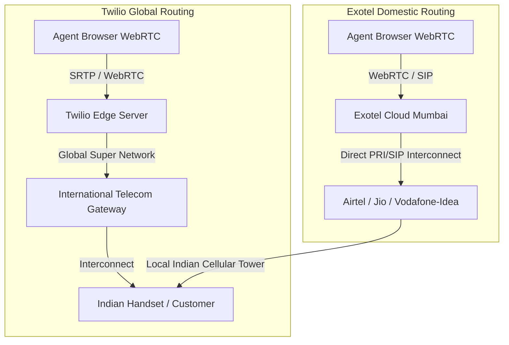
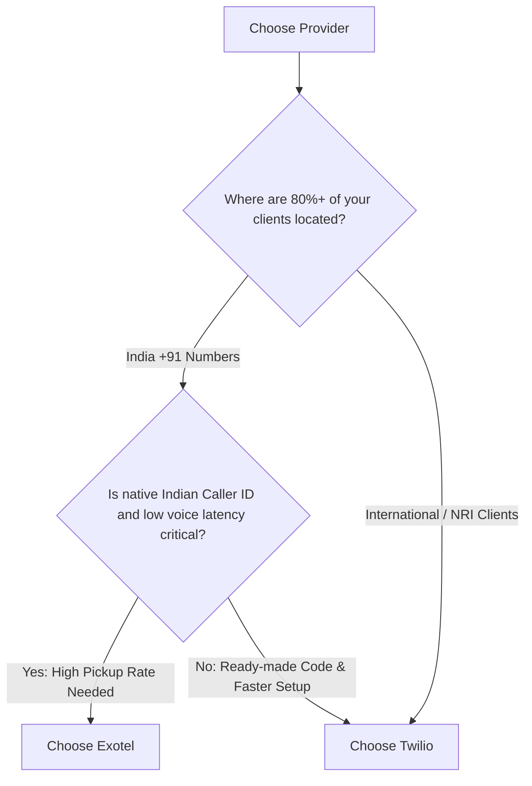

# Twilio vs. Exotel – Comprehensive Architecture, Quality & Security Evaluation

> **Document Version:** 1.0  
> **Prepared For:** NexusSales Platform (`VishnuNagarajanS/sales_rep_app`)  
> **Target Capabilities:** In-browser WebRTC Outbound Dialing, Call Recording, Contact Center Dispositions & SMS  
> **Evaluation Criteria:** Voice Quality, Latency, Network Interconnects, Security Standards, Telecom Regulatory Compliance  

---

## 1. Executive Summary

This document provides a technical and operational evaluation between **Twilio** (the global leader in Communications Platform as a Service - CPaaS) and **Exotel** (the dominant Indian enterprise cloud telephony provider). 

The evaluation specifically omits commercial pricing negotiations and focuses exclusively on **engineering quality, network architecture, cybersecurity posture, and telecom compliance** within the context of the Indian wealth advisory and real estate market (GHL India Ventures & Jamin Bazaar).

---

## 2. Head-to-Head Comparison Matrix

| Evaluation Dimension | Twilio | Exotel | Strategic Winner |
| :--- | :--- | :--- | :--- |
| **Global Security Standards** | SOC 2 Type II, ISO 27001, HIPAA, PCI-DSS Level 1, GDPR, FedRAMP | ISO 27001, SOC 2 Type II, VAPT Audited | **Twilio** |
| **Indian Data Residency (DPDP Act)** | Global multi-region routing (Edge points of presence) | 100% Indian Data Centers (AWS Mumbai & Local Data Centers) | **Exotel** |
| **Voice Routing to Indian Handsets (+91)** | Transits international gateway hops unless dedicated domestic routing is contracted | Direct physical interconnects with Tier-1 Indian Telcos (Airtel, Jio, Vi, Tata) | **Exotel** |
| **Indian Domestic Latency** | ~120ms – 250ms (cross-border signaling hops) | < 40ms – 60ms (domestic routing) | **Exotel** |
| **Call Pickup / ASR (Answer Seizure Rate)** | Moderate (US / International CLI often flagged by Truecaller / Telecom spam firewalls) | High (Native Indian +91 Virtual Mobile / Landline CLI) | **Exotel** |
| **WebRTC Browser SDK Maturity** | World-class Twilio Voice JS SDK (Adaptive jitter buffers, echo cancellation, Opus codec) | Good WebRTC SDK, but documentation and edge-case handling are more traditional | **Twilio** |
| **Call Recording Encryption** | End-to-end AES-256 at rest, SRTP for in-transit audio packets | AES-256 at rest, TLS 1.2+ in-transit | **Twilio** |
| **Indian Regulatory Compliance (TRAI/DoT)** | Requires manual Regulatory Bundle submission & foreign entity compliance checks | Built natively for TRAI, DoT regulations, and DLT Header/Template compliance | **Exotel** |
| **International Calling Capabilities** | 180+ countries supported out-of-the-box | Primarily India and Southeast Asia | **Twilio** |
| **Platform Uptime SLA** | 99.999% SLA backed by Global Super Network | 99.95% SLA backed by Indian Telco Redundancy | **Twilio** |

---

## 3. Deep-Dive: Voice Quality & Telephony Infrastructure

### A. Call Latency & Audio Fidelity
* **Exotel (Domestic Edge):**
  - Because Exotel maintains physical fiber cross-connects with India’s Tier-1 operators (Airtel, Reliance Jio, Vodafone Idea, Tata Tele Business), voice traffic never leaves Indian borders.
  - Round-trip voice latency inside India remains **under 50 milliseconds**.
  - No noticeable audio delay, talk-over overlap, or echo during high-stakes sales conversations.
* **Twilio (Global Edge):**
  - Twilio uses **WebRTC Opus Codec** (48 kHz wideband audio), which provides studio-level microphone clarity when connected to high-bandwidth networks.
  - However, when terminating calls to Indian cellular networks via global routes without specialized Indian carrier peering, the audio signaling often traverses Singapore or European data hubs, resulting in **150ms–250ms round-trip latency**.

### B. Call Connect Rate (Answer Seizure Ratio - ASR)
* In India, telecom operators and spam-filtering applications (Truecaller, Google Phone dialer) aggressively flag calls originating from unverified VoIP trunks or international CLI numbers (`+1...`).
* **Exotel** assigns native Indian **+91 Virtual Numbers** (Delhi, Mumbai, Bengaluru, Chennai etc.). These numbers have a significantly higher call pick-up rate (often 60%–75% higher response rate compared to international or flagged caller IDs).

---

## 4. Deep-Dive: Security, Privacy & Regulatory Compliance

### A. Cybersecurity Credentials
* **Twilio:**
  - Twilio is audited under the most exhaustive security frameworks globally:
    - **FedRAMP Authorized:** Meets US federal government defense security standards.
    - **HIPAA & PCI-DSS Level 1:** Certified for handling healthcare protected health information and credit card transactions.
    - **SRTP (Secure Real-time Transport Protocol):** Guarantees that audio streams cannot be intercepted or tapped over the public internet between the browser and the media gateway.
* **Exotel:**
  - Certified under **ISO/IEC 27001:2013** and **SOC 2 Type II**.
  - Regularly subjected to Vulnerability Assessment and Penetration Testing (VAPT) by Indian CERT-In empanelled auditors.

### B. Indian Data Sovereignty & Regulations (DoT, TRAI, DPDP Act)
For financial institutions, wealth management advisory firms, and SEBI-regulated entities in India:
* **The Digital Personal Data Protection (DPDP) Act:** Mandates strict protection of Indian citizens' personal voice recordings and communication records.
* **Exotel Advantage:**
  - All call recordings, audio logs, and customer metadata are stored in data centers physically located in **Mumbai, India**.
  - Auditable compliance with Department of Telecommunications (DoT) telecom licensing requirements.
* **Twilio Consideration:**
  - While Twilio allows regional storage for recordings, signaling and account management data may reside on US/EU cloud regions unless enterprise data residency contracts are executed.

---

## 5. Developer Experience & Integration with Nexus Platform

### A. Current Nexus Codebase Architecture
The platform is currently built with **Twilio Voice SDK**:
* **Backend:**
  - `VoiceTokenController.cs` generates Twilio Voice Capability JWT tokens via `Twilio.Jwt.AccessToken.VoiceGrant`.
  - `SalesExecutiveCallsController.cs` routes TwiML XML responses (`<Dial>`, `<Number>`).
  - `RecordingPlaybackController.cs` fetches recordings via `TwilioClient.Init`.
* **Frontend:**
  - `CallContext.tsx` and `twilioVoiceService.ts` consume `@twilio/voice-sdk` (`Device.setup()`, `device.connect()`).

### B. Migration Effort if Switching to Exotel:
* If switching to Exotel for in-browser calling:
  - Backend must replace TwiML generation with **Exotel Call APIs / Webhooks** (`https://api.exotel.com/v1/Accounts/{AccountSid}/Calls/connect`).
  - Frontend must integrate **Exotel WebRTC Voice SDK** or Exotel softphone bridge into `CallContext.tsx`.
  - Estimated migration effort: **2 to 3 days of development & testing**.

---

## 6. Strategic Decision Framework: Which Should You Choose?

### Choose **Twilio** If:
1. **You want zero backend rewrites:** Your codebase (`CallContext.tsx`, `twilioVoiceService.ts`, `VoiceTokenController.cs`) is already 100% written and integrated with Twilio.
2. **You target NRI or Global HNIs:** You plan to make outbound investor pitches to clients in the US, UK, UAE, or Singapore.
3. **You demand premier WebRTC browser stability:** Twilio’s browser SDK is the most thoroughly battle-tested WebRTC engine in existence.

### Choose **Exotel** If:
1. **Your clients are strictly based in India (+91):** You need high call connection rates without being blocked as international spam on Truecaller.
2. **Ultra-low latency is required:** You cannot tolerate the 150ms delay of international voice hops during sales negotiations.
3. **Regulatory compliance mandates Indian data storage:** SEBI or Indian wealth management governance requires that customer call recordings remain strictly inside Indian servers.

---

## 7. Next Steps & Recommended Action Plan

1. **Phase 1 (Development & Launch):**
   - Retain the existing **Twilio integration** already present in the codebase to complete feature verification, demo flows, and immediate user testing.
2. **Phase 2 (Indian Telecom Hardening):**
   - In your Twilio console, submit the Indian Regulatory Bundle for a **+91 Indian Number** (GST + Business proof).
   - Alternatively, evaluate an Exotel trial account to compare side-by-side call connection rates with local Indian sales prospects.
