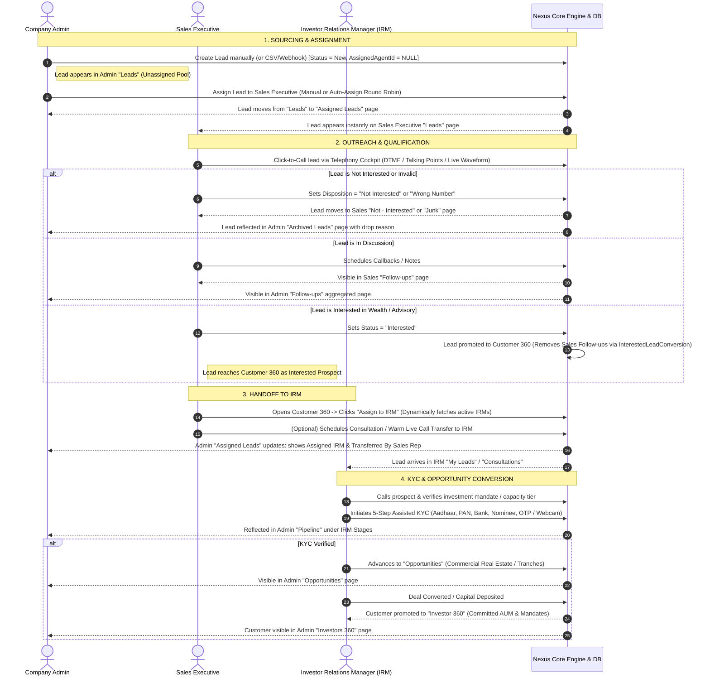
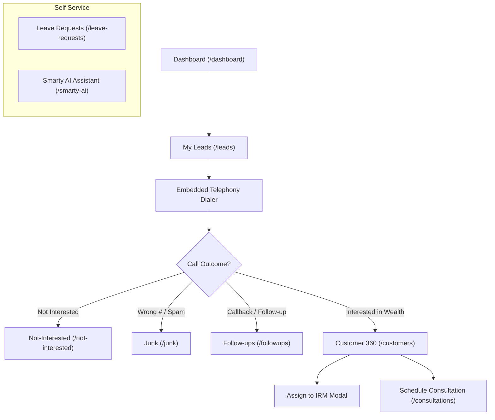

# NexusSales — Complete Role Workflows & Feature Implementation Guide
**Application:** NexusSales CRM & Telephony Cockpit (GHL India Ventures / Wealth & Advisory)  
**Target Roles:** Company Admin, Sales Executive, Investor Relations Manager (IRM), Super Admin  
**Target Path:** `c:\sales_rep_app\scripts\NEXUS_WORKFLOW_AND_IMPLEMENTATION_GUIDE.md`  
**Current Release Version:** Production v2.4 (Neon PostgreSQL, .NET 9 Web API, React 19 + TypeScript + Vite)  
**Branch:** `vishnu-dev` (Ready for merge with `dhinakaran`)  
**Date:** October 2026  

---

## 1. Executive Summary & Core Architectural Principles

NexusSales is an enterprise-grade multi-tenant CRM, Telephony, and Investment Engagement Cockpit. This document serves as the comprehensive manual, operational specification, and **developer merge guide**. It captures:
1. **The Exact End-to-End Operational Workflows** for the **Company Admin**, **Sales Executive**, and **Investor Relations Manager (IRM)** roles.
2. **Detailed Page-by-Page Feature Specifications** explaining what each screen does, why it is designed that way, and how data flows across modules.
3. **Exhaustive Changelog & Implementation History** detailing every architectural shift, new module, security hardening, and bug fix across all versions up to the current release.
4. **Complete File-by-File Inventory of All Changes** across backend and frontend.
5. **Team Merge Conflict Resolution Guide** specifically designed for teammates merging the IRM branch (`dhinakaran`) with this branch (`vishnu-dev`) to ensure zero feature regression and seamless integration.

### 1.1 Non-Negotiable Data Architecture Rules
* **Single-Row Database Principle:** There is **strictly one row per lead, customer, deal, and investor** in the database. When an Admin assigns a lead, when a Sales Executive qualifies a lead to "Interested", or when an Admin hands over an employee's work during leave, the system **never duplicates rows or copies records between tables**. It only updates state columns (`AssignedAgentId`, `Status`, `HandoverId`, `OriginalOwnerId`, `AssignedIrmId`) on that same row.
* **Strict 4-Role Canonical Model:** The application strictly enforces four standardized system roles across backend controllers and frontend navigation:
  1. `super_admin`: Platform owner and SaaS operator.
  2. `company_admin`: Enterprise tenant administrator (CSO / VP of Operations).
  3. `sales_executive`: Frontline sales representative, telecaller, and qualifier.
  4. `irm`: Investor Relations Manager managing high-net-worth (HNI) onboarding, 5-step Assisted KYC, and wealth opportunities.
  *(Note: The legacy `sales_manager` role was systematically eliminated across the entire codebase to maintain pure role scoping).*
* **Database as Single Source of Truth:** All operations, lead allocations, and leave/handover records read directly from Neon PostgreSQL via ASP.NET Core EF Core endpoints. No business logic relies on ephemeral browser storage (`localStorage` / `sessionStorage`) in production mode.
* **Customer 360 Telephony Rule (Latest Update):** In Customer 360 (`CustomersPage.tsx` and `SalesLayout.tsx`), **the call option (Click to Call / list dialer buttons) and the post-call disposition modal have been completely removed for both Admin and Sales Executive**. Telecalling and call dispositions are strictly isolated to active prospecting queues (Leads, Follow-ups, Call Center) and do not clutter relationship management in Customer 360.

---

## 2. End-to-End Lifecycle & Role Interaction Flow

The diagram below illustrates the end-to-end journey of a lead from sourcing to full investor conversion, detailing the exact handoffs between **Company Admin**, **Sales Executive**, and **Investor Relations Manager (IRM)**:



---

## 3. Company Admin: Complete Operational Workflow & Page Breakdown

The **Company Admin** oversees the entire enterprise sales engine, workforce availability, and compliance. Below is the breakdown of each page accessible to the Company Admin:

### 3.1 Leads (`/leads`)
* **Purpose:** The unassigned lead pool and entry terminal for new prospects.
* **Current Sourcing Reality:** External automated ad sources (e.g. Meta Ads, Google Ads, external portals) are architecturally supported via webhooks, but in the current operational version, leads are created **manually by the Admin** (or imported via CSV).
* **Behavior:** 
  * Only displays leads where `AssignedAgentId IS NULL`.
  * Admins can create single leads or bulk-import CSV files with column mapping.
  * Provides quick-action assignment:
    * **Manual Assignment:** Select one or multiple leads, choose an active Sales Executive from the dropdown, and confirm.
    * **Auto-Assignment (Round Robin):** Automatically distributes selected (or all unassigned) leads across all active Sales Executives using a persistent rotation pointer. **Crucially, the algorithm skips any sales agent who is currently on approved leave or covered by a work handover.**
  * Once a lead is assigned, it **instantly leaves this page** and transitions to the **Assigned Leads** page.

### 3.2 Assigned Leads (`/assigned-leads`)
* **Purpose:** The supervisory ledger of all assigned leads and cross-department handoffs.
* **Key Features:**
  * Displays every lead that has been allocated to a sales agent (`AssignedAgentId IS NOT NULL`).
  * **Dual Ownership Resolution (`resolveLeadOwnership`):**
    1. **Assigned Sales Executive:** Displays the sales agent's name, assignment date, and whether that sales agent is currently on leave / covered by another agent.
    2. **Assigned IRM:** Tracks whether the Sales Executive has qualified and transferred this lead to an Investor Relations Manager (`assignedIrmName`, `assignedIrmId`, `assignedIrmAt`).
    3. **Transferred By:** Explicitly logs which Sales Executive originated and qualified the lead (`transferredBySalesExecutiveName`).
  * **Filtering & Actions:** Filter by Sales Executive, IRM, or date ranges (`Today`, `Yesterday`, `This Week`, `This Month`, `Last 30 Days`).
  * **Reassignment Drawer:** Admin can reassign the lead to a different Sales Executive at any time. When reassigned, any pending follow-ups automatically move to the new agent while past call logs remain in the audit trail.

### 3.3 Pending Leads (`/pending-leads`)
* **Purpose:** The SLA watchdog and bottleneck identifier.
* **Why it is used:** Tracks leads that reps are "holding onto" without progressing them to the next stage.
* **Strict Whitelist Logic:**
  * **Sales Executive Pending Leads:** Leads assigned to a Sales Executive that are strictly still in **`New`** status (i.e. untouched, uncontacted leads that have not moved to `Contacted`, `Qualified`, or dispositioned).
  * **IRM Pending Leads:** Leads assigned to an IRM that are strictly in **`Interested`** status (i.e. leads handed over from sales where the IRM has not yet initiated outreach, KYC, or opportunities).
* **Features:**
  * Role filter toggle (`All`, `Sales Executive`, `IRM`) and individual person filter.
  * Direct action to inspect lead timeline or reassign the stuck lead to a different representative immediately.

### 3.4 Follow-ups (`/followups`)
* **Purpose:** Aggregated master schedule of all pending and completed customer engagements.
* **Admin View:**
  * Unlike sales reps who only see their own tasks, the Admin sees all follow-up tasks across both **Sales Executives** and **IRMs**.
  * **Role Filter:** Toggle between `sales_executive` and `irm`.
  * **Person Filter:** Filter by specific sales rep or IRM to inspect their daily callback queue.
  * **Date Presets & Range Picker:** Filter by `Today`, `This Week`, `Overdue`, or custom date spans.
  * **Status & Priority:** Shows `Pending`, `Completed`, and `Overdue` alerts with urgency tags (`Urgent`, `High`, `Medium`).

### 3.5 Customers 360 (`/customers`)
* **Purpose:** Comprehensive relationship repository for qualified and interested accounts.
* **Data Origin:** When a Sales Executive calls a lead and tags them as **`Interested`**, that lead is automatically promoted to Customer 360.
* **Admin Capabilities:**
  * View total committed commercial value, customer profiles, address, and interaction history.
  * **Assign to IRM Modal:** Admin can assign or reassign any interested customer to an IRM.
  * **Dynamic IRM Directory:** Dynamically loads all active IRMs from the database, calculating current load balance and investor ticket capacity tiers.
  * View historical call audio recordings, AI speech-to-text transcripts, associated deals, and compliance documents.
* **Telephony Isolation Update:**
  * **The call option (dial buttons in the customer directory list) and the "Click to Call" header button have been completely removed for both Admin and Sales Executive.**
  * **The call end disposition modal (`DispositionModal`) is explicitly suppressed on the `/customers` route.** Telecalling is strictly restricted to active lead outreach queues.

### 3.6 Pipeline (`/pipeline`)
* **Purpose:** Interactive visual Kanban representation of deals and pipeline progression.
* **Admin Kanban Board (`AdminKanbanBoard.tsx`):**
  * **Role Mode Switcher:** Admin can switch between:
    1. **Sales Executive Pipeline:** Stages: *New Lead → Contacted → Qualified → Proposal → Negotiation → Won / Lost*.
    2. **IRM Pipeline:** Stages: *Leads → Followup → Qualified Investor (KYC) → Investment Opportunity → Converted*.
  * **Filter Bar:** Filter cards by specific representative or date range.
  * **Interactive Cards:** Drag-and-drop cards between stages. Clicking any card opens a detailed slide-out drawer showing full contact details, stage entrance timestamps, deal value, and historical activity notes.

### 3.7 Archived Leads (`/archived-leads`)
* **Purpose:** Centralized graveyard for disqualified leads.
* **Data Origin:** Whenever a Sales Executive marks a lead as **`Not Interested`** or **`Junk` / `Wrong Number`**, the lead leaves the active sales queue and appears here.
* **Features:**
  * Shows lead name, phone, email, former assigned agent, archive timestamp, and specific drop reasons (e.g. "Low Budget", "Competitor Pricing", "Invalid Phone", "Spam").
  * Filter by dropping agent, date range, and status (`Not Interested` vs `Junk`).
  * Enables Admin to audit drop quality or reactivate leads if marketing campaigns re-target them.

### 3.8 Investors 360 (`/investors`)
* **Purpose:** Dedicated portfolio hub for converted High-Net-Worth (HNI) and institutional investors.
* **Data Origin:** Populated when an IRM successfully completes KYC and converts an investor.
* **Features:**
  * Displays investor profile, committed AUM (e.g. ₹1 Cr – ₹25 Cr+), investment mandate, risk appetite (`Conservative`, `Moderate`, `Aggressive`), and tax resident status.
  * Tabbed cockpit: Overview, Call Logs with Audio, Advisory Consultations, Investment Opportunities, and KYC Legal Documents.

### 3.9 Consultations (`/consultations`)
* **Purpose:** Wealth advisory appointment manager connecting clients with IRMs.
* **Workflow:** When a Sales Executive qualifies a lead and schedules an advisory consultation (or performs a warm live call transfer to an IRM), the booking appears here.
* **Features:**
  * Tabs: `All`, `Scheduled`, and `Live Transfers` (warm handoffs).
  * Details: Investor name, phone, assigned wealth consultant (IRM), referring sales executive, scheduled time slot, Google Meet link, and outcome notes (`Completed`, `Rescheduled`, `Cancelled`, `No-show`).

### 3.10 Opportunities (`/opportunities`)
* **Purpose:** Institutional Commercial Real Estate (CRE) and wealth investment tranches.
* **Workflow:** Once an investor's KYC is verified by an IRM, the investor is linked to investment opportunities.
* **Features:**
  * Stages: *Enquiry → Contacted → Consultation → Qualified → Opportunity → Committed → Closed Won / Lost*.
  * Tracks target funding amount, minimum ticket size, committed capital, projected yield (IRR), and close dates.

### 3.11 Users Management (`/users` or `/company/users`)
* **Purpose:** Team administration, role provisioning, and account security.
* **Features:**
  * Create / invite users strictly with the canonical roles: `sales_executive` or `irm`.
  * **Two Provisioning Modes:**
    1. **Email Invite:** Dispatches automated welcome email with login link and temporary password.
    2. **Instant Password Mode:** Generates a secure temporary password and displays it on-screen with a 1-click copy button for immediate verbal handover.
  * **User Controls:** Activate / Deactivate accounts, modify designations, reset passwords.
  * **Admin Transfer Desk:** Safely change an employee's role while reassigning their active leads and customers to prevent orphaned records.
  * **Safe Deletion:** Deleting a user gracefully cleans up or reassigns foreign keys.

### 3.12 Leave Requests (`/leave-requests`)
* **Purpose:** Workforce availability planning and absence governance.
* **Features:**
  * **Team View:** Admin sees all pending, approved, and rejected leave applications submitted by Sales Executives and IRMs.
  * **Workforce Availability Widget:** Real-time indicator showing who is currently on leave, until what date, and whether their work is covered by a colleague.
  * **Approve Modal with Conflict Detection:** When approving leave, the system checks whether teammates of the same role are also on leave and displays a warning banner if >30% of the team would be away.
  * **Reject Modal:** Requires a mandatory rejection reason recorded in the employee's audit log.
  * **"Arrange Handover" Shortcut:** Direct button on approved leave cards that redirects to the Work Handover page with the employee, role, and leave dates pre-filled.
  * **"Handover Not Needed" Option:** Allows the Admin to mark short leaves (e.g. 1-day casual leave) as exempt from handover so system alerts are dismissed.

### 3.13 Work Handover (`/handover`)
* **Purpose:** Complete temporary operational coverage engine during employee leave or emergencies.
* **Workflow:**
  1. Admin chooses the absent user (`fromUser`) and picks a covering colleague (`toUser`) of the **exact same role** (`sales_executive` to `sales_executive`, `irm` to `irm`).
  2. **Smart Cover Suggestions:** System analyzes peer workloads and flags the agent with the lowest open item count as `Recommended`.
  3. **Live Preview:** Displays exact counts of open Leads, Customers, Followups, Deals, Consultations, and Opportunities that will be transferred.
  4. **Start Handover:** In a single atomic database transaction, ownership of all open records shifts to the covering agent. Each record receives `HandoverId` and `OriginalOwnerId`, and an audit row is created in `WorkHandoverItem`.
  5. **Covering Agent Experience:** The covering agent sees the records in their own portal with a prominent **"Handed over from [Name]"** badge. All calls, notes, and stage advancements made during coverage are tracked.
  6. **End Handover:** When the original employee returns (or at any time), Admin clicks "End Handover". **Every record reverts back to the original employee with all updated progress, notes, and stages intact.**
  7. **Early Item Return:** Admin can return individual specific items early if needed.

---

## 4. Sales Executive: Complete Operational Workflow & Page Breakdown

The **Sales Executive** is the frontline telecaller and qualification specialist. Their portal is strictly scoped to their assigned records.



### 4.1 Leads (`/leads`)
* **Strict Scoping:** Sales Executives only see leads where `AssignedAgentId == currentUserId`. They never see leads belonging to other agents or unassigned admin leads.
* **Triage & Actions:**
  * Quick-search, filter by priority (`Urgent`, `High`, `Medium`, `Low`), and filter by lead status (`New`, `Contacted`, `Qualified`, `In Progress`).
  * **Returned from Handover Banner:** If the agent recently returned from leave, leads worked on by a covering colleague display a prominent banner: *"Returned from Handover — Covered by [Name]"*.
  * One-click Call button initiates the embedded web phone.
  * Lead Drawer: View complete activity timeline, past call logs, and notes.

### 4.2 Embedded Telephony & Calling Surface
* **Persistent In-Call Bar:** Remains anchored at the bottom of the screen across active calling pages.
  * Features: Live call timer, Mute/Unmute microphone, Call Hold, quick in-call notes.
  * **Video Meeting Preview:** Utilizes browser camera preview for video consultations.
  * **1-Click Google Meet:** Instantly creates and opens a Google Meet room for face-to-face pitch meetings.
* **Call Center Workspace (`/call-center`):**
  * DTMF digital keypad with audio tones.
  * Lead Queue Navigator: Telecallers can power-dial through lead queues consecutively.
  * Dynamic Talking Points: Displays pitch scripts tailored to the lead's profile.
  * Live Audio Waveform visualizer.
* **Call History (`/call-history`):** Complete log of inbound and outbound calls with direct audio playback and AI speech-to-text transcriptions.

### 4.3 Qualification & Transition to Customer 360
* When a Sales Executive speaks to a prospect and determines they are interested in wealth advisory or commercial investments, the executive updates the lead status to **`Interested`**.
* **Automatic System Actions:**
  * Promotes the record to **Customer 360**.
  * Executes `InterestedLeadConversion.RemoveSalesFollowupsAsync`: deletes pending sales follow-ups so the lead leaves the sales telecalling queue, while preserving completed call history.
  * Retains the lead as a single database row, ready for IRM allocation.

### 4.4 Customer 360 (`/customers`) & Assigning to IRM
* Sales Executives navigate to Customer 360 to view their qualified interested prospects.
* **No In-Cockpit Dialing:** In accordance with latest changes, the call button and post-call disposition popup are removed to keep Customer 360 focused purely on relationship context and IRM allocation.
* **Assign to IRM Workflow:**
  * Rep clicks **"Assign to IRM"**.
  * System dynamically queries all active IRMs (`getCompanyIrms`).
  * Modal displays available IRMs, their current active portfolio count, and capacity tiers.
  * Rep selects an IRM and confirms the transfer.
  * The lead's `AssignedIrmId` and `AssignedIrmName` are saved, and the transfer is recorded in the audit trail.
* **Scheduling Consultation:** Rep can click "Schedule Consultation" to book an appointment directly onto the selected IRM's calendar.

### 4.5 Disqualification: Not-Interested (`/not-interested`) & Junk (`/junk`)
* **Not-Interested:** For leads that explicitly declined the offering. Rep enters a disposition reason (e.g. "Low budget", "Not investing currently").
* **Junk:** For invalid phone numbers, wrong numbers, fake inquiries, or abusive contacts.
* Both screens keep disqualified leads separate from the active daily queue while preserving call history and enabling the Admin to view them in Archived Leads.

### 4.6 Follow-ups (`/followups`)
* Displays personal callback reminders and scheduled tasks.
* Filter by `Due Today`, `Overdue`, and `Upcoming`.
* **Handover Filter Dropdown:** Rep can filter between:
  * `Mine (Regular)`
  * `Covering for [Colleague]` (when covering someone on leave)
  * `Returned from Handover` (tasks completed by a covering agent while the rep was away).
* Reschedule modal allows pushing dates with quick presets (+1 Day, +3 Days, Next Week).

### 4.7 Consultations (`/consultations`)
* Scoped to advisory sessions booked by or assigned to this Sales Executive.
* Supports **Live Call Transfers**: allows sales reps to log warm handoffs where a caller was transferred directly to an IRM on the phone.

### 4.8 Leave Requests (`/leave-requests`)
* Sales Executives submit their personal leave applications:
  * Select Leave Type: `Casual`, `Sick`, `Earned`, `Unpaid`, or `Other`.
  * Options for Full Day or Half Day (First Half / Second Half session).
  * System checks personal balance and prevents overlapping requests.
  * Rep can view real-time balance quotas (`Used`, `Pending`, `Remaining`) and cancel upcoming pending requests.

### 4.9 Smarty AI Assistant (`/smarty-ai`)
* Conversational AI powered by Groq LLM integrated with CRM tools.
* Reps can ask natural language questions: *"Which leads haven't I contacted this week?"*, *"Summarize my calls with Rajesh"*, or *"What follow-ups are overdue?"*.

---

## 5. Investor Relations Manager (IRM): Workflow & Page Breakdown

The **Investor Relations Manager (IRM)** handles high-ticket clients, wealth advisory, compliance KYC, and investment opportunities.

### 5.1 My Leads (`/leads`)
* Scoped strictly to leads assigned to this IRM that are in **`Interested`** status.
* Represents qualified prospects handed over from Sales Executives awaiting wealth profiling.

### 5.2 5-Step Assisted KYC (`/kyc`)
* The core compliance engine for institutional and high-net-worth investors:
  1. **Step 1: Basic Details** (Full legal name, email, phone, gender, investor type: Individual/Corporate/Trust, residency: Resident Indian/NRI/OCI).
  2. **Step 2: Identity Verification** (PAN validation, Aadhaar verification, address, document upload, and **Live Webcam Face Match**).
  3. **Step 3: Banking Credentials** (Bank name, account number, IFSC / SWIFT code, account type).
  4. **Step 4: Nominee Declarations** (Nominee name, relationship, date of birth, allocation percentage).
  5. **Step 5: Verification & OTP Consent** (Sends SMS/Email OTP to investor to capture tamper-proof legal consent).
* **Send KYC Link Modal:** IRM can generate and email/SMS a self-fillable KYC link directly to the investor with tokenized access.
* **Review & Verification:** IRM reviews documents, approves KYC status (`Draft` → `Submitted` → `Under Review` → `Verified`), locking compliance records.

### 5.3 Opportunities & Deals (`/opportunities` & `/deals`)
* Tracks investment tranches (Commercial Real Estate assets, debt funds, equity tranches).
* Stages: *Enquiry → Contacted → Consultation → Qualified → Opportunity → Committed → Closed Won*.
* IRMs pitch opportunities to KYC-verified investors, logging ticket sizes, term sheets, and funding commitment milestones.

### 5.4 Investor 360 (`/investors`)
* Once an opportunity is Closed Won, the contact is registered in Investor 360.
* Tracks ongoing committed AUM, reinvestment horizons, wealth consultations, and legal document dossiers.

### 5.5 Pipeline (`/pipeline`)
* Scoped Kanban board for the IRM displaying the 5 dedicated stages:
  * *Leads → Followup → Qualified Investor (KYC) → Investment Opportunity → Converted*.

---

## 6. Comprehensive Changelog & Version History

```
========================================================================================
CURRENT VERSION: NexusSales v2.4 (GHL Wealth & Telephony Cockpit)
BRANCH: vishnu-dev (Up to date and verified)
========================================================================================
```

### 6.1 Phase 1 — Work Handover & Leave Management v2 Engine
* **Generalized Work Handover Across Roles (`WorkHandoverService.cs`, `WorkHandoverPage.tsx`):**
  * Extended what was previously an IRM-only reassignment hack into a robust enterprise handover system supporting both `sales_executive` and `irm`.
  * Enforced role-equality validation: from-user and to-user must share the exact same canonical role code.
  * Implemented single-row tracking: added `HandoverId` and `OriginalOwnerId` columns across `Leads`, `Customers`, `Followups`, `GhlDeals`, `Consultations`, and `Opportunities`.
  * Created `WorkHandoverItem` relational audit table replacing brittle JSON blob storage.
  * Bidirectional Return Flow: When ending handover, all records automatically revert to their original owners with updated notes, dispositions, and milestones preserved.
* **Leave Management Decoupling (`LeaveRequestsPage.tsx`, `LeaveRequestService.cs`):**
  * Completely separated Leave Requests from automatic Work Handover execution. Approving leave now strictly updates leave status without triggering unwanted automatic handovers.
  * Added Team Leave Calendar and Workforce Availability widget (`/api/ghl/workforce/availability`).
  * Implemented Team Overlap / Conflict Warning (>30% absence warning).
  * Added Leave Policies and calculated balances (`Casual`, `Sick`, `Earned`, `Unpaid`).
  * Fixed DateOnly timezone computation bug for Indian Standard Time (IST) users.

### 6.2 Phase 2 — Lead Assignment & Database Synchronization
* **Single-Table Lead Architecture (`GhlLeadAssignmentController.cs`, `LeadService.cs`):**
  * Eliminated fake local-storage assignment caches. Database is the absolute source of truth.
  * Standardized `AssignedAgentId = NULL` for unassigned admin leads.
  * Implemented `POST /api/ghl/leads/assign` and `/reassign` with audit history logging in `LeadAssignmentHistory`.
  * Implemented persistent Round Robin Auto-Assignment pointer.
  * Auto-assign and agent directory automatically exclude reps who are on approved leave or covered by a handover.
* **Assigned Leads Page Enhancements (`AssignedLeadsPage.tsx`):**
  * Added dual-ownership resolver showing both the assigned Sales Executive and the assigned IRM.
  * Added date range filter presets (`Today`, `Yesterday`, `This Week`, `This Month`, `Last 30 Days`).
  * Added coverage indicators showing whether an agent's work is currently being covered.

### 6.3 Phase 3 — Customer 360 & IRM Dynamic Allocation
* **Dynamic IRM Loading in Customer 360 (`CustomersPage.tsx`, Commit `efa51d3`):**
  * Replaced static IRM mock lists with live API calls (`getCompanyIrms`).
  * Displays all active IRMs dynamically in the Assign to IRM modal.
  * Implemented capacity tier evaluation (Standard, Mid-Tier, High-Net-Worth) and auto-assignment recommendations based on active workload.
* **Lead Qualification Cleanup (`InterestedLeadConversion.cs`):**
  * When a lead status changes to `Interested`, automatically purges open sales follow-ups while preserving completed call history.
  * Promotes lead to Customer 360 seamlessly without duplicating database records.
* **Removal of Call Option & Call End Disposition (Commit Current):**
  * Removed dialer button in the left panel customer directory.
  * Removed "Click to Call" button in the customer cockpit header.
  * Suppressed `DispositionModal` on the `/customers` route in `SalesLayout.tsx`.

### 6.4 Phase 4 — Telephony, Consultations & Disqualifications
* **Drawer Call History & Followup Deduplication (Commit `d83f9af`):**
  * Fixed lead detail drawer to display complete historical call logs and HTML5 audio recordings.
  * Resolved duplicate follow-up generation on customer re-engage.
* **Consultations Role Scoping (`ConsultationsPage.tsx`, Commit `3728b6e`):**
  * Added role-scoped filtering for Sales Executives, IRMs, and Admins.
  * Added `Live Transfers` tab to track warm telephone handoffs between Sales Executives and IRMs.
  * Added Google Meet link generation and status tracking (`Scheduled`, `Completed`, `Rescheduled`, `Cancelled`, `No-show`).
* **Archived Leads Module (`ArchivedLeadsPage.tsx`, Commit `29ff2ab`):**
  * Created dedicated Admin view for dropped leads (`Not Interested` and `Junk` / `Wrong Number`).
  * Captures disposition drop reasons and notes with reactivation capability.

### 6.5 Phase 5 — Returned-from-Handover Experience (Commit `c498673`)
* **Returned-from-Handover Visual Badges & Banners:**
  * Added `IsReturnedFromHandover`, `ReturnedFromHandoverByName`, `ReturnedFromHandoverAt`, and `ReturnedFromHandoverSummary` across backend DTOs and frontend models.
  * Implemented prominent alert banners on `LeadsPage`, `FollowupsPage`, `CustomersPage`, and `DealsPage` for employees returning from leave.
  * Added "Returned from Handover" quick filter options so reps can immediately isolate and review records progressed by their covering colleagues.

### 6.6 Phase 6 — IRM Workflow & KYC Security Enhancements
* **5-Step Assisted KYC Dossier (`KYCPage.tsx`, `KycService.cs`):**
  * Step-by-step wizard: Basic Details, Identity & PAN/Aadhaar documents, Bank credentials, Nominee allocations, and OTP consent.
  * Integrated Live Webcam Face Match for identity verification.
  * Implemented tokenized Send KYC Link modal for investor self-onboarding.
  * Linked verified KYC investors to Investment Opportunities and Investor 360.
* **IRM Pipeline & Capacity Tracking (Commits `c090dbf`, `e967c58`, `02c4133`):**
  * Added dedicated IRM Pipeline board with 5 stages.
  * Duplicate contact prevention and KYC status lifecycle state machine.

### 6.7 Phase 7 — Smarty AI Assistant & Platform Security
* **Smarty AI Assistant (`AiAssistantService.cs`, `SmartyAIPage.tsx`, Commit `ad001dd`):**
  * Integrated Groq LLM with structured CRM function calling (search leads, customers, investors, summarize interactions).
  * Injected pipeline knowledge and company business workflows into system prompt.
  * Hardened prompt injection defenses: client context treated as untrusted data, history capped, strict length limits.
* **Security & Role Governance (Commits `ef8ca8b`, `a4db7cc`):**
  * Completely untracked secrets from git; moved database connection strings and API keys to environment variables.
  * Hardened role enforcement across all endpoints: strictly 4 canonical roles (`super_admin`, `company_admin`, `sales_executive`, `irm`).
  * Cross-tenant query guards: enforced `CompanyId` filtering across all contact and follow-up lookups.

---

## 7. Role Matrix & Operational Permissions

| Module / Feature | Company Admin | Sales Executive | IRM (Investor Relations) | Super Admin |
|---|:---:|:---:|:---:|:---:|
| **Dashboard** | Full Company Metrics | Scoped Personal Targets | Scoped Investor Targets | Cross-Tenant Platform Stats |
| **Leads Page** | Unassigned Pool (`NULL`) | Assigned Only (`my user id`) | Interested Handovers Only | Full Visibility |
| **Lead Assignment** | Manual & Auto Round-Robin | Read-Only | Read-Only | All Companies |
| **Assigned Leads** | Full Audit & IRM Tracking | Hidden | Hidden | Full Audit |
| **Pending Leads** | Full SLA Monitor | Hidden | Hidden | Full Audit |
| **Follow-ups** | All Reps & IRMs | Scoped (Mine / Handover) | Scoped (Mine / Handover) | Global Audit |
| **Customer 360** | All Customers & Reassign | Scoped (Can Assign to IRM) | Scoped (Assigned Accounts) | Full Access |
| **Customer 360 Calling** | **Removed** | **Removed** | **Removed** | **Removed** |
| **Pipeline Kanban** | Toggle Sales & IRM Boards | Scoped Deals | Scoped IRM Pipeline | Global |
| **Archived Leads** | Full Drop Audit & Reactivate | Hidden (Has Not-Int / Junk) | Hidden | Full Audit |
| **Consultations** | All Scheduled & Transfers | Referred / Assigned Only | Assigned Consultant Only | Global |
| **KYC Engine** | Compliance Inspection | Read-Only | Full 5-Step Dossier & OTP | Global Audit |
| **Opportunities** | CRE Tranches & Commitments | Hidden | Manage Pitches & AUM | Global |
| **Investors 360** | Complete Institutional HNI | Hidden | Manage Portfolios & Mandates | Global |
| **Users Management** | Invite/Manage SE & IRM | Profile Only | Profile Only | Manage All Tenants & Roles |
| **Leave Requests** | Review, Approve, Conflict Alerts | Apply & Track Balances | Apply & Track Balances | Platform Oversight |
| **Work Handover** | Start, End, Return Items | Covered/Covering Worker | Covered/Covering Worker | Platform Oversight |
| **Smarty AI Assistant** | Full CRM Intelligence | Sales Rep Intelligence | Investor Intelligence | System Intelligence |

---

## 8. Complete File-by-File Inventory of Changes in `vishnu-dev`

To guarantee that no files or changes are missed during collaboration, below is the exhaustive list of every file modified or introduced in `vishnu-dev` relative to the base branch:

### 8.1 Backend Core & Services
1. `backend/Controllers/GhlAdmin/GhlLeadAssignmentController.cs` — Lead assignment, auto-assign round robin, reassignment, and archived leads API.
2. `backend/Controllers/GhlAdmin/WorkHandoverController.cs` — Handover candidate selection, live preview, start handover, active handovers, return items, and end handover.
3. `backend/Controllers/WorkHandoverUserController.cs` — Returns active/ended coverage banner for logged-in user.
4. `backend/Controllers/LeaveRequestsController.cs` — Leave request submission, approvals, rejections, balances, conflict check, and workforce availability.
5. `backend/Controllers/AiAssistantController.cs` — Chat endpoint with Groq LLM integration and tool calling.
6. `backend/Controllers/ReportsController.cs` & `SalesExecutiveReportsController.cs` — Timestamped CSV export generation.
7. `backend/Services/Implementations/WorkHandoverService.cs` — Core engine managing atomic transfers, `WorkHandoverItem` generation, and bidirectional data return.
8. `backend/Services/Implementations/LeaveRequestService.cs` — Leave balance calculations, company timezone normalization, timeline events, and approval guards.
9. `backend/Services/Implementations/LeadService.cs` — Database-driven lead lifecycle, assignment persistence, unassigned pool filtering, and returned-from-handover mapping.
10. `backend/Services/Implementations/InterestedLeadConversion.cs` — Purges open sales follow-ups when lead becomes Interested while preserving completed history.
11. `backend/Services/Implementations/FollowupService.cs` — Multi-role followup queries, deduplication on customer re-engage, and returned-from-handover mapping.
12. `backend/Services/Implementations/CustomerService.cs` — Customer 360 queries with returned-from-handover DTO mapping.
13. `backend/Services/Implementations/AdminUserService.cs` — User directory, canonical role enforcement, instant password generation, and safe transfer desk.
14. `backend/Services/Implementations/ConsultationService.cs` — Role-scoped advisory consultations and warm call transfer tracking.
15. `backend/Services/Implementations/CompanyClock.cs` — Shared service computing "Today" in the company's local timezone (IST) instead of UTC.
16. `backend/Services/Implementations/ReportService.cs` — Aggregated KPI metrics and CSV reporting engine.
17. `backend/Services/Ai/AiAssistantService.cs` & 12 Tool Classes in `backend/Services/Ai/Tools/` — Function-calling tools querying leads, customers, calls, and handovers.
18. `backend/Services/BackgroundServices/LeaveReminderBackgroundService.cs` — Daily reminders for upcoming approved leaves.
19. `backend/Services/BackgroundServices/HandoverDueDateCheckerService.cs` — Background notifications when a handover reaches its planned end date.

### 8.2 Database Entities & Migrations
1. `backend/Models/Entities/WorkHandover.cs` & `WorkHandoverItem.cs` — Replaced JSON blobs with relational item tracking.
2. `backend/Models/Entities/LeaveRequest.cs`, `LeavePolicy.cs`, `LeaveRequestEvent.cs` — Relational leave tracking with date-only storage.
3. `backend/Models/Entities/LeadAssignmentHistory.cs` — Full audit trail of lead assignment changes.
4. Extended Entities: `Lead`, `Customer`, `Followup`, `GhlDeal`, `Consultation`, `InvestmentOpportunity` now include `HandoverId`, `OriginalOwnerId`, and returned-from-handover audit columns.
5. Entity Configurations: Mappings updated in `ApplicationDbContext.cs` and snapshot.

### 8.3 Frontend Pages & Components
1. `frontend/src/pages/Company/LeaveRequestsPage.tsx` & `.css` — Enterprise Leave Management v2 UI with workforce availability and conflict alerts.
2. `frontend/src/pages/Company/WorkHandoverPage.tsx` & `.css` — Enterprise Work Handover UI with candidate recommendations and return summary.
3. `frontend/src/pages/AssignedLeads/AssignedLeadsPage.tsx` & `.css` — Admin assigned leads with dual-ownership resolver (SE & IRM) and date presets.
4. `frontend/src/pages/PendingLeads/PendingLeadsPage.tsx` & `.css` — Stuck lead watchdog for `New` SE leads and `Interested` IRM leads.
5. `frontend/src/pages/ArchivedLeads/ArchivedLeadsPage.tsx` & `.css` — Graveyard for `Not Interested` and `Junk` leads with drop reasons.
6. `frontend/src/pages/Customers/CustomersPage.tsx` — Dynamic IRM loading, auto-recommendation algorithm, capacity tiers, and **removal of call buttons**.
7. `frontend/src/pages/Pipeline/PipelinePage.tsx` & `AdminKanbanBoard.tsx` — Dual-role Kanban switcher, stage filtering, and card detail drawer.
8. `frontend/src/pages/Followups/FollowupsPage.tsx` — Role and person filters, handover filters, and deduplication fix on re-engage.
9. `frontend/src/pages/Consultations/ConsultationsPage.tsx` — Scoped advisory sessions with dedicated `Live Transfers` tab.
10. `frontend/src/pages/AI/SmartyAIPage.tsx` & `AiAssistant.tsx` — AI chat interface with interactive suggestions.
11. `frontend/src/components/modals/ExportReportModal.tsx` & `.css` — Timestamped CSV export dialog.
12. `frontend/src/layouts/SalesLayout.tsx` — Returned-from-handover modal and suppression of `DispositionModal` on `/customers`.
13. `frontend/src/components/layout/Sidebar.tsx` — Navigation maps strictly rendering canonical roles.
14. `frontend/src/services/` — `workHandoverService.ts`, `leaveRequestService.ts`, `adminUserService.ts`, `adminKanbanService.ts`, `agentDirectory.ts`, `ghlApiService.ts`.

---

## 9. Team Merge Conflict Resolution Guide (For Merging `dhinakaran` with `vishnu-dev`)

When your teammate merges their IRM branch (`dhinakaran`) into this branch (`vishnu-dev`), git may flag merge conflicts in files that both branches touched. **Follow this strict merge guide to ensure no features from either branch are lost:**

### 9.1 Golden Rules During Merge
1. **Never Reintroduce `sales_manager`:** If their branch has `sales_manager` in roles or switch statements, **discard it**. The codebase strictly uses `super_admin`, `company_admin`, `sales_executive`, and `irm`.
2. **Never Revert to Local Storage for Assignment:** In `LeadsPage.tsx`, `AssignedLeadsPage.tsx`, and `CustomersPage.tsx`, always keep the API-driven fetching (`GET /api/sales-executive/leads`, `GET /api/ghl/agents`).
3. **Preserve Single-Row Handover Columns:** Ensure that entity classes in both branches retain `HandoverId` and `OriginalOwnerId`.
4. **Preserve Customer 360 Telephony Isolation:** Do **not** restore the `initiateCall` buttons or call end disposition modal inside `CustomersPage.tsx`.

### 9.2 Key Files Conflict Resolution Checklist

#### 1. `frontend/src/App.tsx` & `Sidebar.tsx`
* **Incoming IRM additions:** May contain new routes or icons for IRM.
* **Keep from `vishnu-dev`:**
  * Route paths for `leave-requests`, `work-handover`, `assigned-leads`, `pending-leads`, `archived-leads`, `smarty-ai`.
  * The canonical navigation blocks: `superAdminSections`, `companySections`, `ghlSalesExecSections`, and `irmSections`.
* **Resolution:** Combine the navigation items cleanly without deleting any Admin/Sales Exec routes.

#### 2. `frontend/src/pages/Customers/CustomersPage.tsx`
* **Incoming IRM additions:** May contain IRM profile links or KYC status badges.
* **Keep from `vishnu-dev`:**
  * Dynamic IRM fetching via `getCompanyIrms(tenant?.id)`.
  * The Assign to IRM modal (`handleSendAssignment`, `runAutoAssignmentAlgorithm`).
  * Returned from handover badges (`isCustomerReturned`).
  * **Keep call buttons REMOVED:** Do not re-add `initiateCall` or the "Click to Call" button.

#### 3. `frontend/src/pages/Pipeline/PipelinePage.tsx` & `AdminKanbanBoard.tsx`
* **Incoming IRM additions:** May contain IRM pipeline board card updates.
* **Keep from `vishnu-dev`:**
  * The dual-role switcher in `AdminKanbanBoard.tsx` allowing Admin to toggle between `sales_executive` and `irm`.
  * Real DB user fetching via `adminUserService.getUsers`.
* **Resolution:** Keep both boards supported so IRM has their dedicated view and Admin can toggle between both.

#### 4. `frontend/src/pages/Followups/FollowupsPage.tsx`
* **Incoming IRM additions:** May contain IRM follow-up details and investment amount fields.
* **Keep from `vishnu-dev`:**
  * The Admin filters for `FollowupRoleFilter` (`sales_executive` vs `irm`) and `selectedPerson`.
  * The Handover filter dropdown (`Mine`, `Covering for [name]`, `Returned from [name]`).
  * Fix preventing duplicate follow-ups on customer re-engage.
* **Resolution:** Merge the IRM custom preference fields with the Admin filter and handover features.

#### 5. `frontend/src/pages/Consultations/ConsultationsPage.tsx`
* **Incoming IRM additions:** May contain IRM consultant actions.
* **Keep from `vishnu-dev`:**
  * The `Live Transfers` tab for warm call transfers.
  * Role scoping for Sales Executive (only seeing consultations they referred or are assigned to).

#### 6. `backend/Services/Implementations/LeadService.cs`
* **Incoming IRM additions:** May contain IRM lead lookup logic.
* **Keep from `vishnu-dev`:**
  * Single-table lead assignment methods.
  * Integration with `InterestedLeadConversion.RemoveSalesFollowupsAsync`.
  * Returned-from-handover DTO mappings.

#### 7. `backend/Services/Implementations/WorkHandoverService.cs`
* **Resolution:** **Keep the `vishnu-dev` version as the canonical implementation.** It fully implements both Sales Executive and IRM coverage, relational item tracking, and bidirectional return flow.

---

## 10. Summary Checklist for Daily Operations

1. **Morning Lead Triage (Admin):**
   * Review unassigned leads in **Leads** (`/leads`).
   * Execute Auto-Assign or Manual Assign to available Sales Executives.
   * Inspect **Pending Leads** (`/pending-leads`) to identify reps holding untouched `New` leads for >24 hours.
2. **Sales Outreach (Sales Executive):**
   * Open **Leads** (`/leads`) and filter by `New` or `Priority`.
   * Open **Follow-ups** (`/followups`) for callbacks scheduled for today.
   * Dial prospects via Embedded Telephony bar; log dispositions.
   * If interested: mark status as `Interested` → open **Customer 360** → assign to active IRM.
   * If disqualified: mark `Not Interested` or `Junk`.
3. **Customer 360 Management (Admin & Sales Executive):**
   * Review customer profiles, commercial valuations, and associated deals.
   * Use the dynamic IRM assignment modal to transfer accounts to available IRMs.
   * *(Telephony dialing is strictly disabled here to keep relationship data clean).*
4. **Wealth Advisory & Closing (IRM):**
   * Check **My Leads** for fresh handoffs in `Interested` status.
   * Review **Consultations** for upcoming advisory sessions and live transfers.
   * Initiate **Assisted KYC** (`/kyc`); send OTP link or complete live webcam face match.
   * Link verified investor to **Opportunities**; log commitments and close deals.
5. **Absence Management (Admin & Employees):**
   * Employee submits request via **Leave Requests** (`/leave-requests`).
   * Admin approves request; checks conflict warnings.
   * Admin opens **Work Handover** (`/handover`), selects covering peer, previews workload, and initiates handover.
   * When employee returns, Admin ends handover; employee resumes work with "Returned from Handover" status banners.

---
*End of Documentation — File maintained under `c:\sales_rep_app\scripts\NEXUS_WORKFLOW_AND_IMPLEMENTATION_GUIDE.md`*
